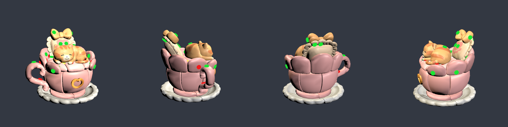
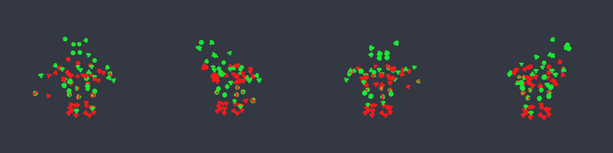
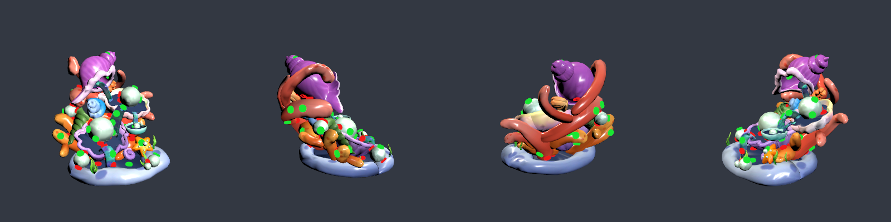
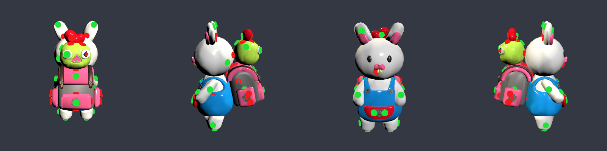
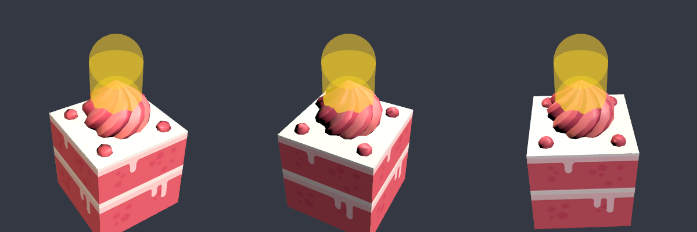
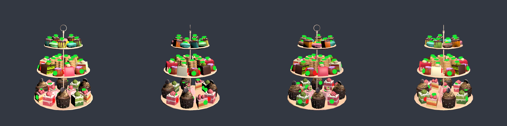
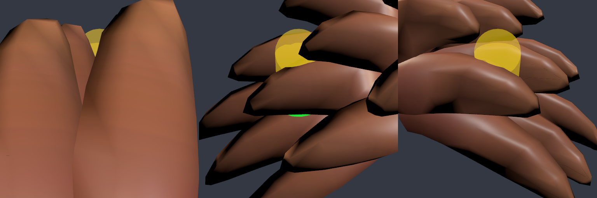
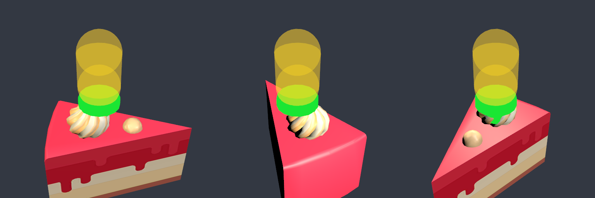
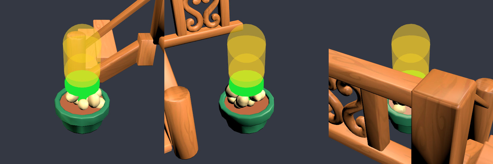

# LevelBake — граф блокировок и валидация уровней

Editor-инструменты, которые из исходных префабов `Assets/UnscrewFirst20/Levels/Level_XX.prefab` и `Data/Level_XX.json`
строят `Assets/_Game/Data/Levels/Level_01..20.json` (`Unscrew.Core.LevelDefinition`, JsonUtility) с заполненными
`bolts[].blockingPartIds`, проверяют полную разбираемость по `BoardRules` и два правила корректности уровня от геймдизайнера.

## Как запустить

- **Unscrew → Validate Levels** — `LevelValidator.ValidateAll(rebake: false)`: свежий бейк в памяти, сравнение с файлами на диске
  («было → стало», колонка «Изменилось болтов» = 0, если файлы актуальны), оба правила; markdown-отчёт в консоль и как результат метода.
- **Unscrew → Validate And Rebake Levels** — `ValidateAll(rebake: true)`: то же, но с перезаписью 20 JSON
  («было» = файлы до перезаписи). Именно этим прогоном получены таблицы ниже.
- **Unscrew → Bake Levels** — `LevelBaker.BakeAll()`: только бейк + короткая таблица.
- Один уровень без записи: `LevelBaker.BakeLevel(n, overrides: null, write: false)` → `BakeResult`
  (определение, сырые попадания свипа, начальные пересечения, нарушения правила 1, разорванные циклы, метрики).
- Скриншоты: `LevelBakePreview.Capture(n, png, yaws, size, pitch, xray, sweepBolts)` — уровень с 4 сторон, болты: зелёный = доступен
  на старте, красный = заблокирован; `sweepBolts` — нарисовать капсулы свипа (жёлтые, полупрозрачные).
  `LevelBakePreview.CaptureBolt(n, boltId, png)` — крупный план одного болта: видны только владелец, блокеры и сам болт + капсула свипа.
  Всё рендерится во временной additive-сцене, которая закрывается без сохранения.
- Ручные правки: `Assets/_Game/Data/Levels/overrides.json` — `{"overrides":[{"level":5,"boltId":12,"add":[3],"remove":[7]}]}`,
  применяются после свипа, до разрыва циклов. Сейчас пусто.
- `LevelBaker.ApplyHeadLift` (по умолчанию `true`) — исправление правила 1 через `headLift` (см. ниже); `false` — прежнее поведение
  (только отчёт, `headLift = 0`), используется для сравнения «до/после».

Файлы: `Assets/_Game/Scripts/Editor/Levels/LevelBaker.cs` (бейк, геометрия болта, свип, циклы), `LevelValidator.cs` (правило 1, отчёт),
`LevelBakePreview.cs`; asmdef `Assets/_Game/Scripts/Editor/Unscrew.Editor.asmdef`. Бейк детерминирован: повторный прогон
`Validate Levels` после ребейка даёт «Изменилось болтов» = 0 на всех 20 уровнях. Время — несколько секунд на все 20 уровней.

## Геометрия болта (измерено по мешу `Screw004`)

Меш один на все уровни. Длинная ось — локальная +Y; в префабе болта `Mesh` повёрнут на 90° по X внутри `TurnTrans`
(scale 12), поэтому «наружу» = `transform.forward` болта (установлено в первом бейке, `bake_01.png`).

| | локально (меш) | в мире (масштаб меша 9.2–14.5 в зависимости от уровня) |
| --- | ---: | ---: |
| Радиус шляпки | 0.0333 | 0.306–0.483 |
| Высота шляпки (Y 0.0227…0.0418) | 0.0191 | 0.176–0.277 |
| Радиус стержня | ≈0.018–0.021 | ≈0.17–0.31 |
| Длина стержня (Y −0.0079…0.0227) | 0.0306 | ≈0.28–0.44 |
| Полная длина болта | 0.0497 | 0.456–0.720 |

Профиль считается из вершин меша (`LevelBaker.GetProfile`): радиус шляпки = максимальный радиус вершин, низ шляпки («посадочная
плоскость», seat) = минимальный Y вершин шире 80% радиуса шляпки. Всё переводится в мир для каждого экземпляра (`GetGeometry`).

## Правило 1 — шляпка не внутри детали-владельца

- 19 точек шляпки: 3 на оси (15%, 50%, 85% высоты шляпки) + 2 кольца по 8 точек на радиусе 0.85·R (на 15% и 60% высоты).
- Тест «точка внутри замкнутого меша» — чётность пересечений луча с non-convex `MeshCollider` владельца (каждый коллайдер детали
  отдельно; `Physics.queriesHitBackfaces = true`, шаг через каждое попадание). 7 фиксированных «косых» направлений, точка внутри,
  если нечётно в ≥4 из 7 (устойчиво к дыркам и рёбрам меша). `Physics.ClosestPoint` для non-convex не работает, поэтому лучи.
- Проверка теста: середина стержня оказывается внутри владельца у 258/264 болтов L01/L06/L12/L19, точка в 5 ед. снаружи — ни разу.
- Глубина = на сколько шляпку нужно сдвинуть наружу вдоль оси, чтобы все «внутренние» точки вышли из владельца
  (максимум по точкам расстояния до выхода вдоль +axis). Нарушения мельче 5% высоты шляпки не считаются (касание посадочной поверхности).

### Исправление: `BoltDefinition.headLift` (бейк 3)

Для каждого болта, нарушающего правило 1, бейк запекает `headLift` — сдвиг наружу вдоль оси болта (мировые единицы уровня:
префаб с корнем в масштабе 1, как он лежит в ассете), после которого шляпка лежит на поверхности владельца, а стержень остаётся в нём.
Остальным болтам `headLift = 0`. Алгоритм (`LevelValidator.ComputeHeadLift`):

1. Минимальный сдвиг измеряется напрямую, а не берётся из «глубины» отчёта: шаг max(0.01, 0.1·h) от 0 до 3× длины болта, на каждом
   шаге все 19 точек шляпки проверяются тем же тестом чётности; на первом шаге, где все снаружи, — 14 итераций бисекции.
2. `headLift` = найденный сдвиг + ε (`LiftEpsilon` = 0.015), округлённый вверх до 0.001. Без ограничения сверху.
3. **Откат** (болт остаётся в исходной позиции, `headLift = 0`, нарушение правила 1 остаётся и попадает в список на ручную правку), если:
   - сдвиг больше полной длины болта (шляпка «висела» бы на голом стержне над пустотой);
   - после сдвига стержень не достаёт до владельца (`ShaftAnchored`: середина стержня внутри владельца **или** отрезок
     «посадка → кончик» пересекает поверхность владельца; второе нужно для тонкостенных владельцев — тарелки, чешуйки, лепестки,
     где стержень проходит деталь насквозь. Со строгой проверкой «середина стержня внутри» откатов было 50 вместо 32, лишние 18 —
     именно такие тонкие детали в L11/L16/L17/L18/L19, включая 6 болтов, у которых середина стержня снаружи уже в исходной позиции);
   - чистой позиции нет в пределах 3× длины болта (шляпка внутри замкнутой полости владельца).
4. Бейк применяет `headLift` **до** свипа правила 2 (`LevelBaker.Shift` сдвигает seat/headCenter/headTop/tip), правило 1 повторно
   проверяется на поднятой позиции; в отчёт идут оба списка (исходные нарушения и оставшиеся после подъёма).
5. В JSON `headLift` пишется с точностью 0.001 (JsonUtility печатает float через double, значение переформатируется).

**Игра (view) обязана применить тот же сдвиг при спавне болта**: `boltTransform.position += boltTransform.forward * headLift`
(`forward` болта совпадает с осью меша, проверено: скалярное произведение 1.0). Если уровень в игре масштабируется (корень префаба ≠ 1),
сдвиг умножается на тот же масштаб: `boltTransform.position += boltTransform.forward * headLift * levelRoot.lossyScale.x`.
Независимая проверка: файлы перечитаны, болты сдвинуты ровно так (через `transform.position`), правило 1 прогнано заново —
нарушения только у 32 откатанных болтов.

## Правило 2 — путь выкручивания свободен (новый алгоритм `blockingPartIds`)

Заменяет прежние «короткий коридор + видимость».

1. Префаб инстанцируется в preview-сцене (своя `PhysicsScene`), каждой детали — non-convex `MeshCollider`, `queriesHitBackfaces = true`.
2. Геометрия болта сдвигается на `headLift` (если он есть), всё дальше считается от поднятой позиции.
   Для каждого болта `PhysicsScene.SphereCast` (non-alloc вариант SphereCastAll, все попадания):
   - **радиус = радиус шляпки** (самая широкая часть, которая проходит путь; 0.306–0.483);
   - **направление** = ось болта наружу (`transform.forward`);
   - **старт**: центр сферы на один радиус выше посадочной плоскости шляпки (`SweepStart.SeatTangent`): стартовая сфера касается
     плоскости, на которой лежит шляпка, и не «ныряет» в поверхность владельца/соседей под ней. Вариант «центр сферы в центре шляпки»
     (`HeadCenter`) проверен: он залезает на R − h/2 ≈ 0.3 под посадочную плоскость и даёт больше ложных касаний
     (971 начальных пересечений против 882 и в полтора раза больше разорванных рёбер — 196 против 127, замер с прежним правилом разрыва ничьих в циклах);
   - **дистанция = длина болта × 1.15** (запас 15%); запас 10/15/20% дают 640/643/646 заблокированных — результат к нему не чувствителен.
3. Каждая деталь ≠ владельца, которую задел свип, — блокер.
4. **Начальные пересечения** (деталь уже пересекает стартовую сферу, SphereCast возвращает distance 0) — тоже блокеры, но перечисляются
   отдельно с глубиной проникновения (`Physics.ComputePenetration` сферы и меша; 0 = касание). Они почти всегда означают, что шляпка
   прижата к соседней детали или та нависает прямо над шляпкой.
5. `overrides.json`.
6. **Циклы**: пока симуляция застревает, ищется цикл среди неснятых деталей (P → Q, если Q блокирует болт P) и выкидывается ребро с
   наибольшим весом. Вес = дистанция попадания свипа; для начального пересечения вес = −глубина проникновения, т. е. сначала выкидываются
   дальние блокеры, затем самые неглубокие касания. Всё логируется (список ниже).
7. **Валидация**: JSON перечитывается `JsonUtility.FromJson<LevelDefinition>` и прогоняется волнами по `BoardRules.IsAccessible`.
   «Глубина» = число волн.

## Результат бейка 3 (headLift): было → стало

«Было» — бейк 2 (свип без `headLift`, файлы до перезаписи), «стало» — свип от поднятых шляпок. «Правило 1» — нарушений на исходных
позициях → после подъёма (остаются только откаты). «headLift > 0» — сколько болтов поднято. Колонка «Разорвано рёбер» — бейк 3.

| Уровень | Болтов | Заблокировано | Доступно на старте | Глубина | Разорвано рёбер | Изменилось болтов | Нач. пересечений (глубоких) | Правило 1 (исх. → после lift) | headLift > 0 | Валиден |
| ---: | ---: | ---: | ---: | ---: | ---: | ---: | ---: | ---: | ---: | :---: |
| 1 | 9 | 0 → 0 | 100% → 100% | 1 → 1 | 0 | 0 | 0 (0) | 3 → 0 | 3 | да |
| 2 | 42 | 10 → 10 | 76% → 76% | 3 → 3 | 0 | 0 | 12 (2) | 3 → 0 | 3 | да |
| 3 | 54 | 14 → 13 | 74% → 76% | 4 → 4 | 0 | 1 | 15 (10) | 7 → 0 | 7 | да |
| 4 | 75 | 26 → 26 | 65% → 65% | 4 → 4 | 0 | 0 | 24 (13) | 9 → 0 | 9 | да |
| 5 | 87 | 33 → 33 | 62% → 62% | 10 → 10 | 8 | 0 | 40 (37) | 29 → 11 | 18 | да |
| 6 | 81 | 43 → 43 | 47% → 47% | 11 → 11 | 16 | 0 | 65 (28) | 0 → 0 | 0 | да |
| 7 | 93 | 27 → 27 | 71% → 71% | 8 → 8 | 14 | 0 | 49 (19) | 5 → 0 | 5 | да |
| 8 | 81 | 17 → 17 | 79% → 79% | 4 → 4 | 0 | 0 | 19 (12) | 11 → 0 | 11 | да |
| 9 | 90 | 35 → 35 | 61% → 61% | 5 → 5 | 1 | 0 | 40 (9) | 3 → 0 | 3 | да |
| 10 | 84 | 43 → 43 | 49% → 49% | 6 → 6 | 0 | 0 | 58 (25) | 2 → 0 | 2 | да |
| 11 | 93 | 38 → 38 | 59% → 59% | 10 → 10 | 19 | 0 | 68 (26) | 13 → 0 | 13 | да |
| 12 | 75 | 36 → 36 | 52% → 52% | 9 → 9 | 7 | 0 | 39 (22) | 6 → 4 | 2 | да |
| 13 | 84 | 38 → 38 | 55% → 55% | 6 → 6 | 10 | 0 | 58 (35) | 4 → 2 | 2 | да |
| 14 | 87 | 34 → 34 | 61% → 61% | 8 → 8 | 0 | 0 | 36 (19) | 1 → 0 | 1 | да |
| 15 | 108 | 55 → 55 | 49% → 49% | 8 → 8 | 0 | 0 | 50 (19) | 3 → 0 | 3 | да |
| 16 | 72 | 18 → 18 | 75% → 75% | 4 → 4 | 0 | 0 | 20 (17) | 17 → 1 | 16 | да |
| 17 | 93 | 33 → 33 | 65% → 65% | 6 → 6 | 17 | 0 | 64 (19) | 10 → 0 | 10 | да |
| 18 | 93 | 34 → 34 | 63% → 63% | 7 → 7 | 5 | 0 | 41 (29) | 21 → 14 | 7 | да |
| 19 | 99 | 55 → 55 | 44% → 44% | 10 → 10 | 42 | 0 | 114 (55) | 5 → 0 | 5 | да |
| 20 | 111 | 50 → 50 | 55% → 55% | 5 → 5 | 0 | 1 | 67 (35) | 9 → 0 | 9 | да |

Итого: 1611 болтов, на старте доступно 972 → 973 (60%), разорвано рёбер 139, начальных пересечений 879, нарушений правила 1 161 → 32, поднято болтов 129. Файлы перезаписаны.

Сравнение с бейком 2 (полный прогон с `ApplyHeadLift = false` и `true`):

| | бейк 2 | бейк 3 |
| --- | ---: | ---: |
| Нарушений правила 1 | 161 | 32 (все — откаты) |
| Поднято болтов | 0 | 129 (headLift 0.026–0.523, среднее 0.151) |
| Заблокировано | 639 | 638 (L03 14 → 13) |
| Доступно на старте | 972 (60.3%) | 973 (60.4%) (L03 40 → 41) |
| Глубина графа | без изменений ни на одном уровне (макс. 11) | |
| Разорвано рёбер | 139 | 139 (по уровням без изменений) |
| Начальных пересечений | 882 | 879 (L03 16 → 15, L20 69 → 67) |
| Болтов с другим набором блокеров | — | 2 (L03 и L20) |

Граф почти не изменился: поднятая шляпка остаётся на той же оси, и капсула свипа (старт на R над посадкой, длина × 1.15) от поднятой
позиции покрывает почти тот же путь. Повторный `Validate Levels` после ребейка — «Изменилось болтов» = 0 на всех 20 уровнях.
Все 20 уровней разбираются.

### Подъёмы по уровням

Поднято 129 болтов: headLift 0.026–0.523, среднее 0.151; headLift / длина болта — макс. 0.88. Измеренный lift − (глубина отчёта + ε): от 0.000 до 0.134.

- L01: b1 0.069, b3 0.039, b6 0.080
- L02: b0 0.127, b1 0.176, b22 0.076
- L03: b20 0.082, b21 0.029, b23 0.105, b28 0.072, b30 0.059, b31 0.075, b45 0.037
- L04: b1 0.073, b5 0.115, b12 0.092, b13 0.031, b22 0.035, b26 0.081, b32 0.081, b36 0.057, b54 0.074
- L05: b7 0.249, b8 0.477, b9 0.488, b10 0.499, b11 0.244, b12 0.252, b13 0.247, b14 0.252, b15 0.486, b16 0.481, b17 0.474, b18 0.486, b19 0.493, b20 0.495, b21 0.493, b33 0.486, b39 0.063, b57 0.523
- L07: b21 0.094, b22 0.100, b23 0.102, b24 0.056, b25 0.112
- L08: b0 0.067, b2 0.062, b9 0.054, b11 0.054, b40 0.045, b47 0.129, b48 0.123, b56 0.044, b57 0.044, b71 0.045, b78 0.029
- L09: b11 0.078, b12 0.027, b26 0.026
- L10: b57 0.043, b59 0.194
- L11: b1 0.430, b16 0.463, b18 0.091, b38 0.039, b40 0.027, b52 0.032, b67 0.080, b68 0.080, b72 0.050, b74 0.083, b80 0.344, b81 0.321, b86 0.202
- L12: b6 0.447, b33 0.098
- L13: b0 0.089, b56 0.030
- L14: b79 0.116
- L15: b8 0.061, b9 0.050, b10 0.059
- L16: b2 0.198, b3 0.107, b8 0.066, b14 0.069, b15 0.030, b19 0.032, b31 0.141, b35 0.031, b36 0.050, b37 0.050, b43 0.082, b45 0.052, b52 0.036, b56 0.030, b66 0.050, b67 0.043
- L17: b1 0.432, b16 0.465, b18 0.078, b38 0.067, b64 0.322, b65 0.345, b74 0.076, b81 0.081, b82 0.081, b89 0.076
- L18: b6 0.222, b15 0.199, b16 0.115, b17 0.300, b38 0.094, b63 0.319, b69 0.123
- L19: b10 0.143, b34 0.037, b35 0.136, b60 0.142, b85 0.253
- L20: b8 0.056, b10 0.069, b15 0.093, b21 0.030, b30 0.084, b35 0.112, b36 0.102, b63 0.108, b65 0.089

Откат (lift отклонён, болт оставлен в исходной позиции, нужна ручная правка): 32.

| Уровень | Болт | Нужный lift | Длина болта | Глубина по отчёту | Причина |
| ---: | ---: | ---: | ---: | ---: | --- |
| 5 | 22 | 1.580 | 0.596 | 0.505 | lift > bolt length |
| 5 | 23 | 0.902 | 0.596 | 0.185 | lift > bolt length |
| 5 | 24 | 0.893 | 0.596 | 0.179 | lift > bolt length |
| 5 | 34 | 1.580 | 0.596 | 0.505 | lift > bolt length |
| 5 | 35 | 0.765 | 0.596 | 0.749 | lift > bolt length |
| 5 | 36 | 0.728 | 0.596 | 0.713 | lift > bolt length |
| 5 | 37 | 0.764 | 0.596 | 0.749 | lift > bolt length |
| 5 | 38 | 0.764 | 0.596 | 0.749 | lift > bolt length |
| 5 | 40 | 1.042 | 0.596 | 0.381 | lift > bolt length |
| 5 | 41 | 1.074 | 0.596 | 0.217 | lift > bolt length |
| 5 | 42 | 1.033 | 0.596 | 0.290 | lift > bolt length |
| 12 | 3 | 0.477 | 0.596 | 0.461 | shaft does not reach the owner after the lift |
| 12 | 15 | 1.022 | 0.596 | 0.204 | lift > bolt length |
| 12 | 23 | 0.665 | 0.596 | 0.649 | lift > bolt length |
| 12 | 44 | 0.723 | 0.596 | 0.708 | lift > bolt length |
| 13 | 5 | 0.934 | 0.596 | 0.184 | lift > bolt length |
| 13 | 66 | 0.933 | 0.596 | 0.072 | lift > bolt length |
| 16 | 16 | 1.470 | 0.596 | 0.032 | lift > bolt length |
| 18 | 1 | ∞ | 0.596 | 0.834 | no clear position within 1.79 (3x bolt length) |
| 18 | 14 | ∞ | 0.596 | 0.585 | no clear position within 1.79 (3x bolt length) |
| 18 | 23 | 1.529 | 0.596 | 0.726 | lift > bolt length |
| 18 | 24 | 1.531 | 0.596 | 1.010 | lift > bolt length |
| 18 | 25 | ∞ | 0.596 | 0.817 | no clear position within 1.79 (3x bolt length) |
| 18 | 26 | ∞ | 0.596 | 0.576 | no clear position within 1.79 (3x bolt length) |
| 18 | 28 | 1.011 | 0.596 | 0.996 | lift > bolt length |
| 18 | 39 | 0.785 | 0.596 | 0.769 | lift > bolt length |
| 18 | 40 | 0.693 | 0.596 | 0.665 | lift > bolt length |
| 18 | 41 | 0.878 | 0.596 | 0.759 | lift > bolt length |
| 18 | 42 | ∞ | 0.596 | 1.057 | no clear position within 1.79 (3x bolt length) |
| 18 | 59 | 1.606 | 0.596 | 0.914 | lift > bolt length |
| 18 | 60 | 1.597 | 0.596 | 0.946 | lift > bolt length |
| 18 | 92 | ∞ | 0.596 | 0.756 | no clear position within 1.79 (3x bolt length) |

«Глубина» из отчёта правила 1 — нижняя оценка: при сдвиге во владелец могут войти другие точки шляпки, поэтому измеренный
подъём бывает до 0.134 больше, чем «глубина + ε».

### Оставшиеся нарушения правила 1 (откаты, нужна ручная правка)

Всего 32: глубина < 0.25 высоты шляпки — 1, 0.25–1 — 6, ≥ 1 (шляпка утоплена целиком) — 25; центр шляпки внутри у 18.

| Уровень | Болт | Владелец | Точек внутри | Центр внутри | Глубина (вдоль оси) | Глубина / высота шляпки |
| ---: | ---: | ---: | ---: | :---: | ---: | ---: |
| 5 | 22 | 22 | 19/19 | да | 0.505 | 2.20 |
| 5 | 23 | 23 | 17/19 | да | 0.185 | 0.80 |
| 5 | 24 | 24 | 17/19 | да | 0.179 | 0.78 |
| 5 | 34 | 34 | 19/19 | да | 0.505 | 2.20 |
| 5 | 35 | 35 | 19/19 | да | 0.749 | 3.26 |
| 5 | 36 | 36 | 12/19 | да | 0.713 | 3.11 |
| 5 | 37 | 37 | 19/19 | да | 0.749 | 3.26 |
| 5 | 38 | 38 | 19/19 | да | 0.749 | 3.26 |
| 5 | 40 | 40 | 12/19 | да | 0.381 | 1.66 |
| 5 | 41 | 41 | 2/19 | нет | 0.217 | 0.94 |
| 5 | 42 | 42 | 4/19 | нет | 0.290 | 1.26 |
| 12 | 3 | 3 | 5/19 | нет | 0.461 | 2.01 |
| 12 | 15 | 15 | 9/19 | нет | 0.204 | 0.89 |
| 12 | 23 | 23 | 13/19 | да | 0.649 | 2.83 |
| 12 | 44 | 0 | 3/19 | нет | 0.708 | 3.08 |
| 13 | 5 | 5 | 4/19 | нет | 0.184 | 0.80 |
| 13 | 66 | 18 | 2/19 | нет | 0.072 | 0.31 |
| 16 | 16 | 16 | 3/19 | нет | 0.032 | 0.14 |
| 18 | 1 | 1 | 13/19 | нет | 0.834 | 3.63 |
| 18 | 14 | 14 | 15/19 | да | 0.585 | 2.55 |
| 18 | 23 | 23 | 19/19 | да | 0.726 | 3.16 |
| 18 | 24 | 24 | 5/19 | нет | 1.010 | 4.40 |
| 18 | 25 | 25 | 10/19 | нет | 0.817 | 3.56 |
| 18 | 26 | 26 | 15/19 | да | 0.576 | 2.51 |
| 18 | 28 | 28 | 9/19 | да | 0.996 | 4.34 |
| 18 | 39 | 26 | 10/19 | нет | 0.769 | 3.35 |
| 18 | 40 | 14 | 6/19 | нет | 0.665 | 2.90 |
| 18 | 41 | 24 | 14/19 | да | 0.759 | 3.31 |
| 18 | 42 | 28 | 8/19 | да | 1.057 | 4.61 |
| 18 | 59 | 26 | 12/19 | да | 0.914 | 3.98 |
| 18 | 60 | 14 | 12/19 | да | 0.946 | 4.12 |
| 18 | 92 | 24 | 10/19 | нет | 0.756 | 3.29 |

Почти все откаты — L05 (кремовые розочки и пирожные, 11) и L18 (шишка, 14): шляпка утоплена на 2–4.6 высоты шляпки,
нужный подъём больше длины болта (0.596). Для них нужен ручной `headLift` или перенос болта (в `overrides.json` такого поля пока нет —
можно добавить `lift`, пока исходные ассеты нельзя править).

## Бейк 2: коридор+видимость → свип (история)

«Было» — бейк коридор+видимость (предыдущая версия), «стало» — свип. «Изменилось болтов» — у скольких болтов другой набор блокеров.
«Нач. пересечений (глубоких)» — начальные пересечения свипа, в скобках глубже 0.05 ед. «Правило 1» — нарушений правила 1.

| Уровень | Болтов | Заблокировано | Доступно на старте | Глубина | Разорвано рёбер | Изменилось болтов | Нач. пересечений (глубоких) | Правило 1 | Валиден |
| ---: | ---: | ---: | ---: | ---: | ---: | ---: | ---: | ---: | :---: |
| 1 | 9 | 0 → 0 | 100% → 100% | 1 → 1 | 0 → 0 | 0 | 0 (0) | 3 | да |
| 2 | 42 | 10 → 10 | 76% → 76% | 3 → 3 | 0 → 0 | 5 | 12 (2) | 3 | да |
| 3 | 54 | 22 → 14 | 59% → 74% | 5 → 4 | 0 → 0 | 8 | 16 (10) | 7 | да |
| 4 | 75 | 25 → 26 | 67% → 65% | 6 → 4 | 0 → 0 | 15 | 24 (13) | 9 | да |
| 5 | 87 | 34 → 33 | 61% → 62% | 7 → 10 | 4 → 8 | 37 | 40 (37) | 29 | да |
| 6 | 81 | 49 → 43 | 40% → 47% | 9 → 11 | 18 → 16 | 43 | 65 (28) | 0 | да |
| 7 | 93 | 38 → 27 | 59% → 71% | 8 → 8 | 15 → 14 | 30 | 49 (19) | 5 | да |
| 8 | 81 | 17 → 17 | 79% → 79% | 4 → 4 | 0 → 0 | 8 | 19 (12) | 11 | да |
| 9 | 90 | 33 → 35 | 63% → 61% | 7 → 5 | 0 → 1 | 14 | 40 (9) | 3 | да |
| 10 | 84 | 45 → 43 | 46% → 49% | 8 → 6 | 2 → 0 | 20 | 58 (25) | 2 | да |
| 11 | 93 | 38 → 38 | 59% → 59% | 5 → 10 | 18 → 19 | 26 | 68 (26) | 13 | да |
| 12 | 75 | 25 → 36 | 67% → 52% | 8 → 9 | 5 → 7 | 24 | 39 (22) | 6 | да |
| 13 | 84 | 30 → 38 | 64% → 55% | 5 → 6 | 4 → 10 | 43 | 58 (35) | 4 | да |
| 14 | 87 | 33 → 34 | 62% → 61% | 7 → 8 | 0 → 0 | 15 | 36 (19) | 1 | да |
| 15 | 108 | 61 → 55 | 44% → 49% | 6 → 8 | 0 → 0 | 20 | 50 (19) | 3 | да |
| 16 | 72 | 16 → 18 | 78% → 75% | 7 → 4 | 0 → 0 | 15 | 20 (17) | 17 | да |
| 17 | 93 | 36 → 33 | 61% → 65% | 7 → 6 | 16 → 17 | 25 | 64 (19) | 10 | да |
| 18 | 93 | 45 → 34 | 52% → 63% | 6 → 7 | 20 → 5 | 26 | 41 (29) | 21 | да |
| 19 | 99 | 45 → 55 | 55% → 44% | 11 → 10 | 44 → 42 | 67 | 114 (55) | 5 | да |
| 20 | 111 | 54 → 50 | 51% → 55% | 5 → 5 | 0 → 0 | 26 | 69 (35) | 9 | да |

Итого: 1611 болтов, заблокировано 656 → 639, на старте доступно 955 → 972 (60%), разорвано рёбер 146 → 139, средняя глубина 6.25 → 6.45 (макс. 11 → 11), начальных пересечений 882, нарушений правила 1 161.
### Сравнение с прежним бейком

- В сумме граф почти той же «плотности»: заблокировано 656 → 639 болтов, доступно на старте 59% → 60%, средняя глубина 6.25 → 6.45,
  разорванных рёбер 146 → 139; набор блокеров поменялся у 467 из 1611 болтов. Все 20 уровней по-прежнему разбираются.
- Стало **свободнее** там, где прежняя проверка видимости блокировала болты, к которым прямой путь вдоль оси открыт, но шляпку
  загораживала далёкая геометрия: L03 59 → 74%, L07 59 → 71%, L18 52 → 63%, L06 40 → 47%.
- Стало **строже** там, где детали плотно прижаты к шляпкам (много начальных пересечений): L12 67 → 52%, L13 64 → 55%, L19 55 → 44%.
- Новое правило не учитывает видимость: болт на дне полости с открытым прямым путём доступен, даже если его не видно с текущего ракурса.
  Тап в игре — raycast только по слою болтов, источник доступности — `BoardRules`, так что это консистентно с геймплеем.
- 882 начальных пересечения (у 431 глубже 0.05) — главный «шум» правила: сфера радиуса шляпки при высоте шляпки ~0.55·R
  касается всего, что лежит вплотную к шляпке. Они блокируют по правилу, но именно из них в основном растут циклы
  (взаимные касания «болт A у детали B, болт B у детали A»); разрыв циклов выкидывает сначала самые неглубокие касания.

## Правило 1: исходные нарушения (до headLift)

Всего 161: глубина < 0.25 высоты шляпки — 49, 0.25–1 — 60, ≥ 1 (шляпка утоплена целиком) — 52; центр шляпки внутри у 40.
По уровням (глубина ≥ 1 высоты шляпки, шляпка утоплена целиком): L05 — 25, L18 — 15, L11/L12/L17 — по 4, L19 — 1.
Мелкие (< 0.25 высоты) — в основном кольцевые точки у самого низа шляпки на выпуклых поверхностях: плоская шляпка на кривой поверхности
краем «уходит» в деталь, визуально это норма. Значимые — средние и глубокие (112 болтов).

Примеры на скриншотах: L05 bolt 35 — шляпка целиком внутри «кремовой розочки» (капсула свипа выходит из неё); L18 bolt 24 — шляпка спрятана
под чешуйкой собственной детали-шишки, по графу болт доступен с самого начала (блокеров нет), но в сборке его не видно.

Исправление реализовано в бейке 3 через `BoltDefinition.headLift` (см. «Правило 1 → Исправление»): 129 из 161 подняты, 32 — откат.

Все 161 нарушение

| Уровень | Болт | Владелец | Точек внутри | Центр внутри | Глубина (вдоль оси) | Глубина / высота шляпки |
| ---: | ---: | ---: | ---: | :---: | ---: | ---: |
| 1 | 1 | 0 | 6/19 | нет | 0.054 | 0.19 |
| 1 | 3 | 1 | 6/19 | нет | 0.023 | 0.08 |
| 1 | 6 | 2 | 6/19 | нет | 0.064 | 0.23 |
| 2 | 0 | 0 | 3/19 | нет | 0.111 | 0.40 |
| 2 | 1 | 0 | 5/19 | нет | 0.161 | 0.58 |
| 2 | 22 | 10 | 3/19 | нет | 0.061 | 0.22 |
| 3 | 20 | 17 | 1/19 | нет | 0.067 | 0.30 |
| 3 | 21 | 21 | 1/19 | нет | 0.013 | 0.06 |
| 3 | 23 | 5 | 4/19 | нет | 0.090 | 0.41 |
| 3 | 28 | 3 | 2/19 | нет | 0.057 | 0.26 |
| 3 | 30 | 1 | 3/19 | нет | 0.044 | 0.20 |
| 3 | 31 | 1 | 3/19 | нет | 0.060 | 0.27 |
| 3 | 45 | 15 | 1/19 | нет | 0.021 | 0.10 |
| 4 | 1 | 28 | 2/19 | нет | 0.058 | 0.30 |
| 4 | 5 | 43 | 4/19 | нет | 0.100 | 0.51 |
| 4 | 12 | 27 | 3/19 | нет | 0.076 | 0.39 |
| 4 | 13 | 0 | 1/19 | нет | 0.015 | 0.08 |
| 4 | 22 | 40 | 1/19 | нет | 0.019 | 0.10 |
| 4 | 26 | 11 | 2/19 | нет | 0.065 | 0.33 |
| 4 | 32 | 53 | 2/19 | нет | 0.066 | 0.34 |
| 4 | 36 | 44 | 3/19 | нет | 0.041 | 0.21 |
| 4 | 54 | 54 | 2/19 | нет | 0.058 | 0.30 |
| 5 | 7 | 7 | 3/19 | да | 0.233 | 1.02 |
| 5 | 8 | 8 | 10/19 | да | 0.461 | 2.01 |
| 5 | 9 | 9 | 9/19 | да | 0.473 | 2.06 |
| 5 | 10 | 10 | 9/19 | да | 0.484 | 2.11 |
| 5 | 11 | 11 | 5/19 | да | 0.228 | 1.00 |
| 5 | 12 | 12 | 5/19 | да | 0.236 | 1.03 |
| 5 | 13 | 13 | 4/19 | да | 0.231 | 1.01 |
| 5 | 14 | 14 | 4/19 | да | 0.236 | 1.03 |
| 5 | 15 | 15 | 9/19 | нет | 0.337 | 1.47 |
| 5 | 16 | 16 | 9/19 | нет | 0.363 | 1.58 |
| 5 | 17 | 17 | 9/19 | нет | 0.334 | 1.45 |
| 5 | 18 | 18 | 9/19 | нет | 0.337 | 1.47 |
| 5 | 19 | 19 | 9/19 | да | 0.477 | 2.08 |
| 5 | 20 | 20 | 9/19 | да | 0.479 | 2.09 |
| 5 | 21 | 21 | 9/19 | да | 0.477 | 2.08 |
| 5 | 22 | 22 | 19/19 | да | 0.505 | 2.20 |
| 5 | 23 | 23 | 17/19 | да | 0.185 | 0.80 |
| 5 | 24 | 24 | 17/19 | да | 0.179 | 0.78 |
| 5 | 33 | 33 | 9/19 | нет | 0.337 | 1.47 |
| 5 | 34 | 34 | 19/19 | да | 0.505 | 2.20 |
| 5 | 35 | 35 | 19/19 | да | 0.749 | 3.26 |
| 5 | 36 | 36 | 12/19 | да | 0.713 | 3.11 |
| 5 | 37 | 37 | 19/19 | да | 0.749 | 3.26 |
| 5 | 38 | 38 | 19/19 | да | 0.749 | 3.26 |
| 5 | 39 | 39 | 2/19 | нет | 0.047 | 0.21 |
| 5 | 40 | 40 | 12/19 | да | 0.381 | 1.66 |
| 5 | 41 | 41 | 2/19 | нет | 0.217 | 0.94 |
| 5 | 42 | 42 | 4/19 | нет | 0.290 | 1.26 |
| 5 | 57 | 22 | 17/19 | да | 0.508 | 2.21 |
| 7 | 21 | 21 | 4/19 | нет | 0.079 | 0.34 |
| 7 | 22 | 22 | 4/19 | нет | 0.085 | 0.37 |
| 7 | 23 | 23 | 4/19 | нет | 0.086 | 0.38 |
| 7 | 24 | 24 | 4/19 | нет | 0.041 | 0.18 |
| 7 | 25 | 25 | 5/19 | нет | 0.096 | 0.42 |
| 8 | 0 | 0 | 2/19 | нет | 0.051 | 0.24 |
| 8 | 2 | 1 | 2/19 | нет | 0.046 | 0.21 |
| 8 | 9 | 4 | 2/19 | нет | 0.039 | 0.18 |
| 8 | 11 | 5 | 2/19 | нет | 0.039 | 0.18 |
| 8 | 40 | 23 | 2/19 | нет | 0.030 | 0.14 |
| 8 | 47 | 27 | 18/19 | да | 0.113 | 0.53 |
| 8 | 48 | 28 | 18/19 | да | 0.107 | 0.50 |
| 8 | 56 | 33 | 2/19 | нет | 0.028 | 0.13 |
| 8 | 57 | 34 | 2/19 | нет | 0.028 | 0.13 |
| 8 | 71 | 41 | 1/19 | нет | 0.029 | 0.14 |
| 8 | 78 | 45 | 1/19 | нет | 0.014 | 0.06 |
| 9 | 11 | 3 | 3/19 | нет | 0.063 | 0.36 |
| 9 | 12 | 4 | 1/19 | нет | 0.012 | 0.07 |
| 9 | 26 | 40 | 1/19 | нет | 0.010 | 0.06 |
| 10 | 57 | 24 | 2/19 | нет | 0.028 | 0.11 |
| 10 | 59 | 25 | 8/19 | нет | 0.178 | 0.68 |
| 11 | 1 | 1 | 11/19 | да | 0.415 | 1.81 |
| 11 | 16 | 16 | 11/19 | нет | 0.344 | 1.50 |
| 11 | 18 | 18 | 8/19 | нет | 0.075 | 0.33 |
| 11 | 38 | 1 | 7/19 | нет | 0.024 | 0.10 |
| 11 | 40 | 8 | 1/19 | нет | 0.012 | 0.05 |
| 11 | 52 | 5 | 3/19 | нет | 0.016 | 0.07 |
| 11 | 67 | 6 | 1/19 | нет | 0.065 | 0.28 |
| 11 | 68 | 7 | 1/19 | нет | 0.065 | 0.28 |
| 11 | 72 | 1 | 1/19 | нет | 0.035 | 0.15 |
| 11 | 74 | 0 | 1/19 | нет | 0.067 | 0.29 |
| 11 | 80 | 20 | 4/19 | нет | 0.328 | 1.43 |
| 11 | 81 | 21 | 2/19 | нет | 0.305 | 1.33 |
| 11 | 86 | 23 | 7/19 | нет | 0.187 | 0.81 |
| 12 | 3 | 3 | 5/19 | нет | 0.461 | 2.01 |
| 12 | 6 | 6 | 13/19 | да | 0.432 | 1.88 |
| 12 | 15 | 15 | 9/19 | нет | 0.204 | 0.89 |
| 12 | 23 | 23 | 13/19 | да | 0.649 | 2.83 |
| 12 | 33 | 10 | 2/19 | нет | 0.083 | 0.36 |
| 12 | 44 | 0 | 3/19 | нет | 0.708 | 3.08 |
| 13 | 0 | 0 | 3/19 | нет | 0.073 | 0.32 |
| 13 | 5 | 5 | 4/19 | нет | 0.184 | 0.80 |
| 13 | 56 | 7 | 1/19 | нет | 0.015 | 0.06 |
| 13 | 66 | 18 | 2/19 | нет | 0.072 | 0.31 |
| 14 | 79 | 43 | 3/19 | нет | 0.100 | 0.46 |
| 15 | 8 | 3 | 1/19 | нет | 0.046 | 0.25 |
| 15 | 9 | 4 | 1/19 | нет | 0.034 | 0.19 |
| 15 | 10 | 5 | 1/19 | нет | 0.043 | 0.23 |
| 16 | 2 | 2 | 6/19 | нет | 0.064 | 0.28 |
| 16 | 3 | 3 | 6/19 | нет | 0.066 | 0.29 |
| 16 | 8 | 8 | 4/19 | нет | 0.030 | 0.13 |
| 16 | 14 | 14 | 4/19 | нет | 0.054 | 0.23 |
| 16 | 15 | 15 | 9/19 | нет | 0.015 | 0.06 |
| 16 | 16 | 16 | 3/19 | нет | 0.032 | 0.14 |
| 16 | 19 | 19 | 7/19 | нет | 0.016 | 0.07 |
| 16 | 31 | 14 | 5/19 | нет | 0.125 | 0.54 |
| 16 | 35 | 9 | 3/19 | нет | 0.016 | 0.07 |
| 16 | 36 | 12 | 3/19 | нет | 0.035 | 0.15 |
| 16 | 37 | 7 | 3/19 | нет | 0.035 | 0.15 |
| 16 | 43 | 10 | 2/19 | нет | 0.067 | 0.29 |
| 16 | 45 | 13 | 4/19 | нет | 0.037 | 0.16 |
| 16 | 52 | 19 | 4/19 | нет | 0.016 | 0.07 |
| 16 | 56 | 15 | 8/19 | нет | 0.015 | 0.06 |
| 16 | 66 | 14 | 2/19 | нет | 0.035 | 0.15 |
| 16 | 67 | 13 | 1/19 | нет | 0.027 | 0.12 |
| 17 | 1 | 1 | 11/19 | да | 0.416 | 1.81 |
| 17 | 16 | 16 | 11/19 | нет | 0.346 | 1.51 |
| 17 | 18 | 18 | 8/19 | нет | 0.062 | 0.27 |
| 17 | 38 | 1 | 1/19 | нет | 0.051 | 0.22 |
| 17 | 64 | 21 | 2/19 | нет | 0.307 | 1.34 |
| 17 | 65 | 20 | 4/19 | нет | 0.330 | 1.44 |
| 17 | 74 | 0 | 1/19 | нет | 0.060 | 0.26 |
| 17 | 81 | 6 | 1/19 | нет | 0.065 | 0.28 |
| 17 | 82 | 7 | 1/19 | нет | 0.065 | 0.28 |
| 17 | 89 | 0 | 1/19 | нет | 0.060 | 0.26 |
| 18 | 1 | 1 | 13/19 | нет | 0.834 | 3.63 |
| 18 | 6 | 6 | 14/19 | да | 0.130 | 0.57 |
| 18 | 14 | 14 | 15/19 | да | 0.585 | 2.55 |
| 18 | 15 | 15 | 3/19 | нет | 0.184 | 0.80 |
| 18 | 16 | 16 | 1/19 | нет | 0.100 | 0.43 |
| 18 | 17 | 17 | 5/19 | нет | 0.284 | 1.24 |
| 18 | 23 | 23 | 19/19 | да | 0.726 | 3.16 |
| 18 | 24 | 24 | 5/19 | нет | 1.010 | 4.40 |
| 18 | 25 | 25 | 10/19 | нет | 0.817 | 3.56 |
| 18 | 26 | 26 | 15/19 | да | 0.576 | 2.51 |
| 18 | 28 | 28 | 9/19 | да | 0.996 | 4.34 |
| 18 | 38 | 6 | 2/19 | нет | 0.078 | 0.34 |
| 18 | 39 | 26 | 10/19 | нет | 0.769 | 3.35 |
| 18 | 40 | 14 | 6/19 | нет | 0.665 | 2.90 |
| 18 | 41 | 24 | 14/19 | да | 0.759 | 3.31 |
| 18 | 42 | 28 | 8/19 | да | 1.057 | 4.61 |
| 18 | 59 | 26 | 12/19 | да | 0.914 | 3.98 |
| 18 | 60 | 14 | 12/19 | да | 0.946 | 4.12 |
| 18 | 63 | 6 | 10/19 | нет | 0.197 | 0.86 |
| 18 | 69 | 8 | 3/19 | нет | 0.108 | 0.47 |
| 18 | 92 | 24 | 10/19 | нет | 0.756 | 3.29 |
| 19 | 10 | 10 | 3/19 | нет | 0.097 | 0.42 |
| 19 | 34 | 34 | 1/19 | нет | 0.021 | 0.09 |
| 19 | 35 | 35 | 2/19 | да | 0.120 | 0.52 |
| 19 | 60 | 10 | 3/19 | нет | 0.094 | 0.41 |
| 19 | 85 | 7 | 6/19 | нет | 0.237 | 1.03 |
| 20 | 8 | 8 | 9/19 | нет | 0.041 | 0.21 |
| 20 | 10 | 10 | 3/19 | нет | 0.053 | 0.27 |
| 20 | 15 | 15 | 10/19 | да | 0.078 | 0.39 |
| 20 | 21 | 20 | 1/19 | нет | 0.014 | 0.07 |
| 20 | 30 | 26 | 9/19 | нет | 0.068 | 0.35 |
| 20 | 35 | 27 | 17/19 | да | 0.097 | 0.49 |
| 20 | 36 | 27 | 10/19 | да | 0.086 | 0.43 |
| 20 | 63 | 36 | 2/19 | нет | 0.093 | 0.47 |
| 20 | 65 | 37 | 2/19 | нет | 0.074 | 0.37 |

## Начальные пересечения свипа (бейк 3, от поднятых шляпок)

Всего 879, из них глубже 0.050 — 431. Формат: b<болт>←p<деталь> (глубина проникновения стартовой сферы).

Список по уровням

- L02: b1←p16 (0.285), b9←p2 (0.000), b12←p4 (0.000), b13←p4 (0.000), b17←p6 (0.000), b18←p6 (0.000), b21←p8 (0.000), b25←p5 (0.021), b25←p3 (0.000), b27←p5 (0.407), b27←p7 (0.000), b31←p1 (0.000)
- L03: b22←p22 (0.000), b26←p21 (0.085), b26←p15 (0.148), b28←p15 (0.203), b28←p21 (0.185), b30←p15 (0.354), b30←p21 (0.236), b31←p21 (0.277), b31←p15 (0.368), b36←p5 (0.146), b37←p0 (0.361), b46←p18 (0.000), b47←p18 (0.000), b50←p21 (0.000), b53←p16 (0.000)
- L04: b0←p32 (0.048), b0←p47 (0.014), b2←p29 (0.129), b12←p10 (0.000), b13←p32 (0.260), b18←p33 (0.000), b29←p18 (0.173), b31←p49 (0.091), b31←p47 (0.277), b34←p32 (0.141), b34←p34 (0.339), b37←p6 (0.000), b37←p17 (0.035), b40←p29 (0.000), b41←p49 (0.277), b45←p49 (0.017), b45←p34 (0.277), b53←p45 (0.000), b64←p41 (0.315), b68←p41 (0.244), b72←p47 (0.178), b73←p29 (0.009), b74←p34 (0.026), b74←p32 (0.204)
- L05: b0←p14 (0.258), b0←p18 (0.126), b25←p24 (0.259), b25←p42 (0.344), b26←p20 (0.110), b26←p30 (0.211), b44←p25 (0.000), b45←p26 (0.000), b46←p28 (0.061), b46←p6 (0.123), b47←p2 (0.082), b47←p30 (0.061), b48←p28 (0.057), b48←p6 (0.100), b50←p2 (0.058), b50←p30 (0.056), b60←p26 (0.219), b61←p26 (0.219), b62←p26 (0.219), b63←p26 (0.219), b64←p26 (0.219), b65←p26 (0.219), b66←p0 (0.217), b67←p0 (0.216), b68←p0 (0.214), b69←p0 (0.214), b70←p0 (0.261), b71←p25 (0.220), b72←p25 (0.220), b74←p21 (0.283), b75←p10 (0.343), b76←p19 (0.228), b77←p20 (0.122), b78←p8 (0.400), b79←p9 (0.124), b80←p25 (0.208), b81←p39 (0.000), b82←p39 (0.297), b86←p28 (0.253), b86←p6 (0.113)
- L06: b0←p26 (0.127), b1←p25 (0.089), b3←p13 (0.362), b4←p13 (0.000), b5←p13 (0.236), b6←p34 (0.115), b6←p28 (0.000), b10←p12 (0.000), b12←p13 (0.000), b15←p13 (0.305), b16←p30 (0.110), b16←p33 (0.000), b16←p14 (0.029), b17←p27 (0.000), b17←p32 (0.115), b18←p22 (0.000), b18←p31 (0.118), b18←p35 (0.015), b21←p3 (0.000), b22←p31 (0.000), b22←p35 (0.263), b23←p15 (0.210), b24←p9 (0.000), b32←p15 (0.000), b32←p12 (0.108), b33←p30 (0.000), b33←p14 (0.280), b34←p3 (0.105), b34←p4 (0.000), b38←p29 (0.000), b39←p29 (0.000), b41←p32 (0.000), b44←p6 (0.150), b45←p22 (0.000), b45←p18 (0.150), b46←p16 (0.150), b47←p27 (0.000), b47←p17 (0.150), b48←p14 (0.005), b48←p27 (0.000), b48←p32 (0.069), b49←p30 (0.080), b49←p33 (0.000), b50←p22 (0.000), b50←p35 (0.083), b51←p29 (0.077), b51←p28 (0.000), b53←p7 (0.000), b55←p9 (0.000), b56←p7 (0.035), b58←p1 (0.188), b59←p0 (0.223), b64←p30 (0.148), b64←p31 (0.000), b66←p35 (0.000), b66←p34 (0.277), b67←p32 (0.358), b67←p14 (0.000), b69←p31 (0.342), b69←p35 (0.000), b70←p21 (0.000), b71←p10 (0.000), b75←p14 (0.000), b76←p31 (0.000), b78←p30 (0.000)
- L07: b1←p8 (0.384), b1←p7 (0.400), b2←p3 (0.400), b2←p4 (0.384), b14←p11 (0.362), b14←p12 (0.000), b15←p11 (0.362), b15←p12 (0.000), b16←p17 (0.194), b18←p15 (0.000), b18←p12 (0.024), b19←p18 (0.360), b20←p27 (0.000), b27←p31 (0.140), b29←p23 (0.205), b46←p6 (0.024), b46←p3 (0.282), b46←p4 (0.000), b47←p20 (0.000), b49←p28 (0.000), b50←p15 (0.000), b50←p11 (0.024), b58←p6 (0.000), b58←p4 (0.190), b62←p12 (0.000), b65←p12 (0.000), b67←p12 (0.000), b69←p12 (0.000), b73←p28 (0.000), b74←p15 (0.000), b74←p11 (0.024), b77←p28 (0.183), b77←p20 (0.000), b78←p15 (0.400), b78←p14 (0.400), b79←p15 (0.400), b79←p14 (0.400), b80←p18 (0.390), b80←p19 (0.372), b81←p17 (0.006), b82←p6 (0.000), b83←p5 (0.000), b84←p4 (0.000), b85←p3 (0.000), b86←p10 (0.000), b87←p9 (0.000), b88←p8 (0.000), b89←p7 (0.000), b92←p28 (0.000)
- L08: b1←p2 (0.093), b3←p3 (0.089), b5←p43 (0.155), b7←p42 (0.177), b19←p6 (0.000), b21←p7 (0.000), b22←p29 (0.000), b22←p33 (0.219), b23←p30 (0.000), b23←p34 (0.219), b36←p17 (0.000), b38←p18 (0.000), b47←p24 (0.191), b48←p24 (0.191), b49←p33 (0.226), b50←p34 (0.226), b62←p32 (0.336), b63←p32 (0.318), b74←p35 (0.000)
- L09: b5←p5 (0.000), b7←p0 (0.000), b8←p0 (0.000), b9←p35 (0.000), b10←p36 (0.000), b14←p34 (0.039), b15←p6 (0.108), b39←p8 (0.000), b40←p8 (0.000), b41←p28 (0.000), b42←p27 (0.000), b43←p8 (0.000), b44←p20 (0.000), b45←p9 (0.000), b56←p20 (0.054), b58←p24 (0.001), b58←p25 (0.018), b59←p24 (0.248), b59←p25 (0.000), b60←p23 (0.035), b60←p24 (0.000), b60←p25 (0.263), b61←p24 (0.284), b61←p25 (0.289), b62←p10 (0.000), b63←p41 (0.284), b64←p10 (0.000), b65←p40 (0.055), b69←p18 (0.000), b74←p42 (0.000), b75←p19 (0.306), b78←p21 (0.000), b80←p22 (0.017), b81←p16 (0.000), b82←p16 (0.000), b83←p15 (0.000), b84←p39 (0.000), b85←p39 (0.000), b88←p19 (0.000), b89←p19 (0.000)
- L10: b4←p40 (0.155), b4←p14 (0.441), b7←p40 (0.000), b8←p5 (0.000), b14←p5 (0.000), b15←p5 (0.000), b16←p4 (0.000), b17←p12 (0.405), b17←p13 (0.000), b18←p20 (0.000), b18←p22 (0.221), b20←p21 (0.281), b20←p20 (0.000), b22←p20 (0.096), b22←p8 (0.000), b23←p0 (0.000), b24←p12 (0.000), b25←p8 (0.000), b25←p36 (0.163), b26←p2 (0.000), b27←p12 (0.000), b31←p0 (0.000), b32←p2 (0.000), b33←p1 (0.000), b34←p3 (0.000), b39←p9 (0.000), b39←p20 (0.147), b40←p14 (0.260), b40←p1 (0.000), b41←p13 (0.000), b42←p9 (0.000), b42←p36 (0.156), b43←p40 (0.014), b43←p3 (0.000), b44←p13 (0.000), b46←p7 (0.000), b47←p6 (0.000), b49←p7 (0.000), b50←p6 (0.000), b52←p21 (0.455), b53←p22 (0.455), b59←p15 (0.473), b61←p23 (0.437), b61←p25 (0.455), b62←p24 (0.455), b63←p25 (0.392), b63←p26 (0.370), b65←p23 (0.530), b66←p23 (0.265), b66←p25 (0.258), b76←p35 (0.000), b77←p35 (0.000), b82←p24 (0.326), b82←p28 (0.000), b82←p26 (0.391), b83←p23 (0.326), b83←p25 (0.388), b83←p27 (0.000)
- L11: b2←p1 (0.295), b2←p4 (0.103), b3←p2 (0.000), b5←p2 (0.000), b6←p19 (0.000), b6←p5 (0.298), b7←p19 (0.000), b7←p5 (0.298), b8←p11 (0.214), b9←p8 (0.000), b9←p10 (0.279), b12←p9 (0.034), b12←p5 (0.000), b13←p19 (0.000), b14←p13 (0.000), b14←p19 (0.238), b19←p2 (0.000), b22←p2 (0.000), b25←p19 (0.000), b26←p13 (0.000), b26←p20 (0.302), b26←p22 (0.226), b28←p22 (0.000), b34←p22 (0.000), b35←p2 (0.000), b36←p19 (0.000), b39←p2 (0.040), b39←p1 (0.354), b41←p5 (0.173), b43←p7 (0.302), b43←p13 (0.000), b46←p19 (0.000), b47←p19 (0.000), b50←p22 (0.000), b52←p9 (0.073), b52←p8 (0.039), b53←p2 (0.096), b53←p0 (0.334), b54←p7 (0.000), b55←p2 (0.080), b55←p23 (0.086), b56←p4 (0.036), b60←p6 (0.320), b61←p22 (0.000), b61←p19 (0.262), b62←p22 (0.000), b63←p20 (0.000), b64←p12 (0.000), b65←p19 (0.000), b66←p19 (0.000), b69←p17 (0.187), b71←p6 (0.000), b72←p4 (0.055), b73←p2 (0.000), b76←p21 (0.319), b76←p22 (0.000), b77←p4 (0.354), b78←p22 (0.000), b79←p21 (0.000), b82←p19 (0.000), b83←p19 (0.000), b85←p19 (0.000), b87←p14 (0.303), b87←p13 (0.000), b89←p2 (0.000), b90←p4 (0.366), b92←p14 (0.302), b92←p13 (0.000)
- L12: b4←p22 (0.060), b4←p7 (0.031), b7←p8 (0.000), b7←p11 (0.040), b8←p11 (0.000), b9←p12 (0.338), b11←p10 (0.204), b14←p9 (0.340), b16←p19 (0.000), b16←p17 (0.000), b16←p22 (0.235), b17←p7 (0.117), b18←p13 (0.163), b19←p22 (0.079), b20←p19 (0.000), b21←p10 (0.043), b22←p4 (0.000), b27←p16 (0.000), b29←p9 (0.045), b29←p11 (0.347), b31←p4 (0.000), b34←p20 (0.224), b36←p5 (0.037), b38←p10 (0.196), b38←p11 (0.154), b40←p19 (0.000), b40←p16 (0.302), b41←p20 (0.114), b42←p17 (0.400), b44←p20 (0.217), b47←p4 (0.323), b48←p22 (0.400), b49←p12 (0.000), b52←p4 (0.282), b61←p22 (0.080), b63←p10 (0.188), b67←p16 (0.359), b68←p5 (0.000), b69←p12 (0.000)
- L13: b1←p3 (0.104), b1←p5 (0.000), b2←p20 (0.000), b9←p8 (0.233), b9←p10 (0.000), b10←p14 (0.094), b13←p3 (0.079), b13←p10 (0.000), b16←p15 (0.000), b26←p10 (0.000), b26←p13 (0.113), b27←p12 (0.376), b28←p13 (0.388), b29←p19 (0.378), b30←p1 (0.386), b32←p4 (0.373), b33←p4 (0.374), b35←p16 (0.000), b36←p2 (0.000), b44←p13 (0.388), b45←p12 (0.373), b46←p1 (0.387), b48←p19 (0.375), b51←p4 (0.269), b52←p4 (0.269), b53←p4 (0.000), b54←p4 (0.000), b55←p4 (0.000), b55←p3 (0.200), b61←p18 (0.000), b61←p3 (0.234), b62←p8 (0.000), b62←p3 (0.187), b63←p9 (0.356), b63←p3 (0.000), b64←p1 (0.383), b65←p5 (0.148), b67←p4 (0.159), b68←p4 (0.159), b69←p21 (0.077), b71←p3 (0.171), b71←p4 (0.000), b74←p3 (0.082), b74←p10 (0.000), b75←p18 (0.000), b75←p3 (0.171), b76←p3 (0.145), b76←p5 (0.000), b77←p8 (0.000), b77←p3 (0.139), b78←p10 (0.000), b78←p13 (0.011), b80←p21 (0.111), b81←p11 (0.255), b82←p17 (0.256), b83←p3 (0.121), b83←p0 (0.045), b83←p4 (0.000)
- L14: b11←p3 (0.000), b14←p6 (0.000), b35←p32 (0.000), b37←p34 (0.074), b37←p31 (0.042), b38←p18 (0.000), b38←p19 (0.131), b39←p20 (0.142), b39←p19 (0.000), b40←p20 (0.000), b41←p21 (0.042), b44←p24 (0.000), b45←p25 (0.108), b45←p26 (0.060), b46←p26 (0.000), b48←p28 (0.000), b48←p29 (0.097), b49←p29 (0.000), b49←p30 (0.085), b50←p30 (0.000), b52←p34 (0.181), b53←p35 (0.165), b65←p24 (0.164), b70←p18 (0.299), b70←p19 (0.072), b71←p21 (0.000), b72←p22 (0.000), b73←p23 (0.214), b73←p24 (0.087), b74←p33 (0.244), b75←p43 (0.038), b76←p28 (0.052), b76←p29 (0.079), b76←p27 (0.017), b77←p42 (0.246), b83←p44 (0.073)
- L15: b3←p7 (0.080), b3←p6 (0.000), b4←p7 (0.080), b4←p6 (0.000), b7←p32 (0.000), b13←p5 (0.038), b25←p10 (0.000), b27←p9 (0.000), b28←p11 (0.000), b35←p36 (0.000), b36←p36 (0.000), b37←p36 (0.000), b38←p36 (0.000), b39←p36 (0.000), b40←p36 (0.000), b41←p34 (0.000), b43←p18 (0.212), b43←p34 (0.000), b44←p35 (0.000), b44←p18 (0.210), b45←p29 (0.206), b45←p34 (0.000), b46←p35 (0.000), b46←p29 (0.212), b53←p54 (0.177), b54←p54 (0.022), b54←p53 (0.000), b55←p54 (0.291), b55←p40 (0.243), b55←p39 (0.265), b55←p53 (0.000), b56←p36 (0.000), b56←p54 (0.301), b57←p50 (0.000), b58←p50 (0.000), b60←p0 (0.000), b61←p0 (0.000), b62←p50 (0.000), b69←p15 (0.103), b69←p14 (0.000), b71←p16 (0.000), b72←p1 (0.000), b72←p2 (0.268), b94←p39 (0.322), b94←p55 (0.249), b97←p55 (0.267), b98←p55 (0.267), b99←p37 (0.000), b99←p55 (0.128), b100←p55 (0.295)
- L16: b1←p19 (0.335), b4←p5 (0.182), b7←p5 (0.052), b8←p2 (0.212), b13←p20 (0.239), b17←p3 (0.277), b18←p19 (0.071), b24←p18 (0.033), b24←p15 (0.000), b34←p5 (0.162), b35←p17 (0.092), b45←p16 (0.277), b49←p20 (0.229), b50←p14 (0.167), b50←p5 (0.318), b61←p13 (0.167), b61←p20 (0.267), b62←p4 (0.152), b62←p5 (0.282), b70←p18 (0.000)
- L17: b2←p1 (0.407), b2←p4 (0.103), b3←p2 (0.000), b5←p2 (0.000), b6←p19 (0.000), b6←p5 (0.298), b7←p19 (0.000), b7←p5 (0.298), b8←p10 (0.179), b9←p11 (0.365), b9←p8 (0.000), b12←p5 (0.000), b12←p9 (0.044), b13←p19 (0.000), b14←p13 (0.000), b14←p19 (0.200), b19←p2 (0.000), b22←p2 (0.000), b25←p19 (0.000), b26←p17 (0.000), b27←p14 (0.000), b28←p22 (0.000), b29←p19 (0.000), b33←p22 (0.000), b35←p19 (0.000), b36←p2 (0.000), b38←p2 (0.400), b39←p2 (0.040), b39←p1 (0.357), b40←p10 (0.367), b40←p8 (0.000), b43←p17 (0.000), b44←p14 (0.000), b46←p19 (0.000), b51←p22 (0.000), b52←p9 (0.105), b52←p8 (0.039), b53←p2 (0.000), b54←p6 (0.000), b55←p2 (0.096), b55←p0 (0.334), b56←p2 (0.080), b56←p23 (0.084), b57←p0 (0.000), b59←p22 (0.000), b59←p19 (0.262), b60←p22 (0.000), b61←p20 (0.000), b63←p12 (0.000), b66←p19 (0.000), b67←p19 (0.000), b68←p7 (0.000), b72←p14 (0.000), b75←p4 (0.355), b76←p22 (0.000), b77←p21 (0.000), b79←p19 (0.000), b80←p19 (0.000), b83←p19 (0.000), b85←p14 (0.000), b85←p13 (0.323), b87←p14 (0.000), b90←p0 (0.034), b91←p4 (0.367)
- L18: b0←p9 (0.241), b0←p4 (0.144), b8←p15 (0.145), b8←p12 (0.021), b9←p12 (0.229), b9←p13 (0.000), b10←p25 (0.166), b11←p1 (0.016), b14←p28 (0.293), b19←p1 (0.018), b20←p10 (0.068), b22←p14 (0.213), b23←p12 (0.121), b23←p24 (0.266), b26←p28 (0.300), b27←p9 (0.286), b36←p27 (0.000), b36←p2 (0.213), b39←p15 (0.233), b40←p28 (0.000), b40←p25 (0.243), b40←p24 (0.185), b41←p25 (0.056), b43←p3 (0.104), b58←p25 (0.060), b59←p28 (0.247), b60←p28 (0.251), b62←p17 (0.044), b65←p24 (0.200), b66←p23 (0.000), b66←p24 (0.043), b69←p9 (0.200), b69←p5 (0.158), b76←p13 (0.037), b77←p1 (0.060), b78←p23 (0.000), b79←p1 (0.189), b80←p16 (0.168), b80←p25 (0.162), b83←p23 (0.133), b91←p13 (0.035)
- L19: b0←p1 (0.059), b0←p5 (0.000), b0←p6 (0.133), b1←p6 (0.400), b2←p9 (0.000), b3←p1 (0.052), b3←p5 (0.000), b3←p6 (0.160), b5←p2 (0.000), b6←p5 (0.000), b6←p9 (0.000), b9←p25 (0.075), b9←p22 (0.255), b12←p16 (0.000), b12←p13 (0.000), b13←p35 (0.135), b13←p12 (0.000), b14←p18 (0.225), b14←p16 (0.000), b15←p27 (0.000), b15←p23 (0.347), b15←p25 (0.028), b15←p26 (0.045), b15←p22 (0.000), b17←p13 (0.018), b17←p21 (0.233), b17←p9 (0.000), b19←p13 (0.014), b19←p15 (0.255), b19←p27 (0.167), b19←p23 (0.149), b19←p22 (0.378), b20←p16 (0.000), b20←p18 (0.227), b21←p22 (0.001), b21←p9 (0.267), b23←p30 (0.000), b24←p29 (0.083), b25←p31 (0.000), b26←p28 (0.000), b27←p32 (0.000), b28←p22 (0.181), b28←p29 (0.272), b30←p22 (0.122), b30←p24 (0.099), b30←p29 (0.190), b31←p22 (0.178), b31←p29 (0.096), b32←p22 (0.122), b32←p29 (0.068), b33←p32 (0.000), b33←p27 (0.070), b36←p14 (0.000), b36←p13 (0.024), b37←p20 (0.000), b37←p13 (0.016), b40←p1 (0.232), b40←p5 (0.000), b40←p6 (0.104), b45←p5 (0.165), b45←p9 (0.285), b46←p23 (0.000), b47←p26 (0.000), b48←p27 (0.000), b49←p6 (0.329), b50←p25 (0.000), b51←p23 (0.000), b52←p25 (0.000), b53←p27 (0.000), b54←p26 (0.000), b55←p1 (0.241), b58←p2 (0.264), b59←p1 (0.245), b59←p5 (0.000), b59←p8 (0.022), b61←p36 (0.080), b62←p37 (0.088), b63←p9 (0.000), b64←p9 (0.115), b65←p9 (0.089), b68←p9 (0.000), b69←p20 (0.000), b73←p16 (0.000), b74←p13 (0.047), b74←p16 (0.027), b75←p6 (0.329), b76←p1 (0.280), b77←p19 (0.052), b77←p17 (0.061), b77←p21 (0.283), b77←p13 (0.078), b78←p30 (0.000), b79←p1 (0.271), b79←p5 (0.000), b79←p11 (0.289), b80←p9 (0.000), b83←p1 (0.036), b83←p5 (0.000), b83←p6 (0.248), b84←p1 (0.041), b84←p5 (0.000), b84←p6 (0.243), b86←p36 (0.022), b87←p37 (0.027), b89←p14 (0.000), b90←p13 (0.018), b92←p13 (0.016), b93←p13 (0.206), b94←p16 (0.061), b94←p13 (0.242), b95←p6 (0.377), b96←p1 (0.297), b98←p5 (0.000), b98←p11 (0.000)
- L20: b0←p47 (0.243), b0←p48 (0.238), b0←p49 (0.262), b0←p50 (0.263), b0←p51 (0.000), b0←p46 (0.315), b3←p6 (0.304), b8←p30 (0.000), b8←p45 (0.227), b9←p30 (0.037), b9←p45 (0.277), b9←p8 (0.000), b10←p45 (0.123), b11←p13 (0.292), b11←p11 (0.288), b12←p13 (0.349), b12←p14 (0.369), b13←p14 (0.185), b15←p35 (0.100), b15←p30 (0.000), b15←p45 (0.229), b16←p15 (0.000), b16←p30 (0.004), b16←p45 (0.244), b17←p18 (0.170), b17←p19 (0.000), b18←p20 (0.180), b18←p18 (0.303), b19←p20 (0.000), b30←p22 (0.290), b31←p22 (0.267), b32←p22 (0.097), b33←p42 (0.345), b34←p39 (0.000), b35←p23 (0.154), b36←p24 (0.179), b37←p25 (0.000), b39←p40 (0.000), b40←p41 (0.326), b41←p37 (0.000), b42←p36 (0.000), b44←p21 (0.133), b45←p35 (0.184), b46←p33 (0.000), b47←p33 (0.000), b48←p34 (0.000), b49←p34 (0.000), b50←p32 (0.329), b51←p32 (0.000), b52←p31 (0.000), b53←p31 (0.000), b63←p38 (0.000), b80←p40 (0.004), b81←p39 (0.010), b82←p41 (0.014), b83←p42 (0.003), b84←p30 (0.000), b84←p33 (0.239), b85←p30 (0.000), b86←p34 (0.194), b86←p30 (0.000), b87←p35 (0.330), b87←p30 (0.000), b88←p30 (0.000), b88←p33 (0.201), b88←p44 (0.215), b90←p26 (0.001)

## Скриншоты

Зелёный — болт доступен на старте, красный — заблокирован; жёлтая капсула — свип выкручивания. Ракурсы: спереди, справа, сзади, слева.

- Level_01, капсулы свипа у болтов 0 и 6 (длина капсулы ≈ длина болта × 1.15 + 2R): 
- Level_06 (чашка):  и только болты: 
- Level_12: 
- Level_19: 
- Правило 1, L05 bolt 35 (шляпка внутри владельца): 
- Правило 1, L18 bolt 24 (шляпка под чешуйкой своей детали): 
- Начальное пересечение, L02 bolt 27 (золотая деталь 5 нависает над шляпкой, глубина 0.41): 

Бейк 3 (`LevelBakePreview` применяет `headLift` так же, как игра):

- Level_05 целиком (4 стороны), шляпки поднятых болтов лежат на пирожных: 
- L05 bolt 35 — откат (нужен подъём 0.765 > длины болта 0.596), шляпка по-прежнему внутри розочки: 
- L18 bolt 24 — откат (нужно 1.531), шляпка под чешуйкой шишки: 
- Поднятые: L05 bolt 8 (headLift 0.477, шляпка на вершине кремовой спирали): ,
  L11 bolt 16 (0.463, шляпка над грибами в горшке): 

Скриншоты бейка 2 (`bake2_*`) — исходные позиции болтов. Прежние скриншоты бейка коридор+видимость: `bake_01/06/12/19.png`.

## Ограничения и замечания

- Сфера радиуса шляпки — грубая модель плоской шляпки (высота ~0.55·R): капсула свипа длиннее реального пути шляпки
  примерно на 2R − h, и задевает детали, лежащие вплотную к шляпке. Это сознательно по правилу; ложные блокировки, если найдутся
  на плейтесте, правятся через `overrides.json` (`remove`).
- Геометрические циклы есть в 10 уровнях (L19 — 42 ребра); после разрыва часть болтов формально доступна, хотя путь шляпки задет.
- Level_01 тривиален: блокировок нет.
- `headLift` проверяется только против владельца: поднятая шляпка может встать вплотную к соседней детали — это учитывает свип
  правила 2 (он стартует от поднятой позиции), но визуально стоит проверить L05/L11/L17 (подъёмы 0.4–0.5).
- 32 болта (L05, L12, L13, L16, L18) оставлены в исходной позиции с нарушением правила 1 — список выше, нужна ручная правка.
- Интеграционные тесты (`test.sh All`, бот на 20 уровнях) и EditMode `Unscrew.Core.Tests` зелёные на новых данных.

## Журнал разорванных циклов

139 рёбер

- L05: cycle [0->14->0]: dropped part 0 blocking part 14 (initial overlap, depth 0.217)
- L05: cycle [6->9->6]: dropped part 6 blocking part 9 (initial overlap, depth 0.123)
- L05: cycle [26->6->9->28->26]: dropped part 28 blocking part 9 (initial overlap, depth 0.061)
- L05: cycle [20->2->20]: dropped part 2 blocking part 20 (initial overlap, depth 0.082)
- L05: cycle [26->20->30->26]: dropped part 30 blocking part 20 (initial overlap, depth 0.061)
- L05: cycle [25->24->25]: dropped part 25 blocking part 24 (initial overlap, depth 0.220)
- L05: cycle [26->28->26]: dropped part 26 blocking part 28 (initial overlap, depth 0.219)
- L05: cycle [26->30->26]: dropped part 30 blocking part 26 (initial overlap, depth 0.211)
- L06: cycle [0->26->0]: dropped part 26 blocking part 0 (initial overlap, depth 0.127)
- L06: cycle [2->30->2]: dropped part 2 blocking part 30 (dist 0.553)
- L06: cycle [31->2->30->31]: dropped part 2 blocking part 31 (dist 0.526)
- L06: cycle [31->30->31]: dropped part 30 blocking part 31 (dist 0.000)
- L06: cycle [13->29->13]: dropped part 29 blocking part 13 (dist 0.669)
- L06: cycle [13->34->3->13]: dropped part 34 blocking part 13 (dist 0.571)
- L06: cycle [3->21->3]: dropped part 21 blocking part 3 (dist 0.000)
- L06: cycle [4->34->4]: dropped part 4 blocking part 34 (dist 0.000)
- L06: cycle [35->4->35]: dropped part 4 blocking part 35 (dist 0.532)
- L06: cycle [1->25->1]: dropped part 25 blocking part 1 (initial overlap, depth 0.089)
- L06: cycle [14->15->14]: dropped part 15 blocking part 14 (dist 0.522)
- L06: cycle [12->10->12]: dropped part 10 blocking part 12 (dist 0.000)
- L06: cycle [14->32->14]: dropped part 32 blocking part 14 (dist 0.000)
- L06: cycle [6->28->18->22->16->33->17->27->6]: dropped part 28 blocking part 6 (dist 0.000)
- L06: cycle [7->36->7]: dropped part 36 blocking part 7 (dist 0.265)
- L06: cycle [15->32->15]: dropped part 15 blocking part 32 (dist 0.000)
- L07: cycle [7->8->7]: dropped part 8 blocking part 7 (dist 0.000)
- L07: cycle [4->3->4]: dropped part 3 blocking part 4 (dist 0.000)
- L07: cycle [12->4->12]: dropped part 12 blocking part 4 (dist 0.000)
- L07: cycle [6->5->6]: dropped part 5 blocking part 6 (dist 0.000)
- L07: cycle [12->6->12]: dropped part 6 blocking part 12 (dist 0.000)
- L07: cycle [14->11->14]: dropped part 11 blocking part 14 (initial overlap, depth 0.362)
- L07: cycle [12->14->12]: dropped part 12 blocking part 14 (dist 0.000)
- L07: cycle [15->11->15]: dropped part 11 blocking part 15 (initial overlap, depth 0.362)
- L07: cycle [12->15->12]: dropped part 12 blocking part 15 (dist 0.000)
- L07: cycle [15->18->11->15]: dropped part 11 blocking part 18 (initial overlap, depth 0.024)
- L07: cycle [12->15->18->12]: dropped part 12 blocking part 18 (initial overlap, depth 0.024)
- L07: cycle [15->18->15]: dropped part 15 blocking part 18 (dist 0.000)
- L07: cycle [9->10->9]: dropped part 10 blocking part 9 (dist 0.000)
- L07: cycle [20->27->20]: dropped part 27 blocking part 20 (dist 0.000)
- L09: cycle [19->21->19]: dropped part 21 blocking part 19 (dist 0.317)
- L11: cycle [1->4->2->1]: dropped part 2 blocking part 4 (dist 0.000)
- L11: cycle [1->4->19->2->1]: dropped part 19 blocking part 4 (dist 0.480)
- L11: cycle [2->19->2]: dropped part 19 blocking part 2 (dist 0.000)
- L11: cycle [2->22->2]: dropped part 22 blocking part 2 (dist 0.000)
- L11: cycle [0->23->0]: dropped part 23 blocking part 0 (initial overlap, depth 0.086)
- L11: cycle [5->9->5]: dropped part 9 blocking part 5 (initial overlap, depth 0.105)
- L11: cycle [5->12->5]: dropped part 12 blocking part 5 (dist 0.000)
- L11: cycle [5->19->22->13->6->5]: dropped part 19 blocking part 5 (dist 0.000)
- L11: cycle [6->19->22->13->6]: dropped part 19 blocking part 6 (dist 0.000)
- L11: cycle [7->19->22->13->14->7]: dropped part 14 blocking part 13 (dist 0.063)
- L11: cycle [7->19->22->13->17->12->7]: dropped part 12 blocking part 17 (dist 0.570)
- L11: cycle [13->17->13]: dropped part 13 blocking part 17 (dist 0.061)
- L11: cycle [7->19->22->13->17->14->7]: dropped part 14 blocking part 17 (dist 0.072)
- L11: cycle [19->22->13->17->19]: dropped part 19 blocking part 17 (dist 0.634)
- L11: cycle [19->22->13->19]: dropped part 22 blocking part 19 (dist 0.000)
- L11: cycle [13->21->22->13]: dropped part 22 blocking part 21 (dist 0.000)
- L11: cycle [13->22->13]: dropped part 22 blocking part 13 (dist 0.000)
- L11: cycle [14->20->22->14]: dropped part 22 blocking part 20 (dist 0.000)
- L11: cycle [14->22->14]: dropped part 22 blocking part 14 (initial overlap, depth 0.226)
- L12: cycle [7->8->7]: dropped part 7 blocking part 8 (dist 0.208)
- L12: cycle [17->7->8->17]: dropped part 8 blocking part 7 (dist 0.000)
- L12: cycle [19->16->19]: dropped part 16 blocking part 19 (dist 0.000)
- L12: cycle [4->5->4]: dropped part 4 blocking part 5 (dist 0.000)
- L12: cycle [22->4->22]: dropped part 22 blocking part 4 (dist 0.347)
- L12: cycle [6->18->6]: dropped part 18 blocking part 6 (dist 0.491)
- L12: cycle [9->12->9]: dropped part 9 blocking part 12 (dist 0.398)
- L13: cycle [1->3->10->5->1]: dropped part 10 blocking part 3 (dist 0.414)
- L13: cycle [3->13->3]: dropped part 13 blocking part 3 (initial overlap, depth 0.011)
- L13: cycle [1->5->1]: dropped part 5 blocking part 1 (dist 0.000)
- L13: cycle [2->20->2]: dropped part 20 blocking part 2 (dist 0.000)
- L13: cycle [8->9->8]: dropped part 8 blocking part 9 (initial overlap, depth 0.233)
- L13: cycle [10->13->10]: dropped part 10 blocking part 13 (dist 0.000)
- L13: cycle [8->19->8]: dropped part 8 blocking part 19 (dist 0.000)
- L13: cycle [11->17->11]: dropped part 11 blocking part 17 (initial overlap, depth 0.255)
- L13: cycle [12->18->12]: dropped part 18 blocking part 12 (dist 0.000)
- L13: cycle [15->16->15]: dropped part 16 blocking part 15 (dist 0.000)
- L17: cycle [0->1->0]: dropped part 0 blocking part 1 (dist 0.000)
- L17: cycle [1->2->1]: dropped part 2 blocking part 1 (initial overlap, depth 0.330)
- L17: cycle [0->1->23->0]: dropped part 23 blocking part 1 (dist 0.330)
- L17: cycle [0->2->4->0]: dropped part 0 blocking part 4 (initial overlap, depth 0.034)
- L17: cycle [2->4->2]: dropped part 2 blocking part 4 (dist 0.000)
- L17: cycle [2->4->19->2]: dropped part 19 blocking part 4 (dist 0.310)
- L17: cycle [2->19->2]: dropped part 19 blocking part 2 (dist 0.000)
- L17: cycle [2->22->2]: dropped part 22 blocking part 2 (dist 0.000)
- L17: cycle [0->23->0]: dropped part 23 blocking part 0 (initial overlap, depth 0.084)
- L17: cycle [5->12->5]: dropped part 12 blocking part 5 (dist 0.000)
- L17: cycle [19->22->19]: dropped part 22 blocking part 19 (dist 0.000)
- L17: cycle [13->14->13]: dropped part 14 blocking part 13 (dist 0.000)
- L17: cycle [13->17->13]: dropped part 13 blocking part 17 (dist 0.102)
- L17: cycle [13->17->14->13]: dropped part 17 blocking part 13 (dist 0.102)
- L17: cycle [14->17->14]: dropped part 14 blocking part 17 (dist 0.041)
- L17: cycle [20->22->20]: dropped part 22 blocking part 20 (dist 0.000)
- L17: cycle [21->22->21]: dropped part 22 blocking part 21 (dist 0.000)
- L18: cycle [0->4->0]: dropped part 0 blocking part 4 (dist 0.111)
- L18: cycle [9->5->27->9]: dropped part 5 blocking part 9 (dist 0.148)
- L18: cycle [14->24->14]: dropped part 14 blocking part 24 (dist 0.102)
- L18: cycle [24->26->28->24]: dropped part 24 blocking part 28 (dist 0.460)
- L18: cycle [21->20->21]: dropped part 21 blocking part 20 (dist 0.341)
- L19: cycle [1->6->1]: dropped part 1 blocking part 6 (initial overlap, depth 0.245)
- L19: cycle [2->9->2]: dropped part 9 blocking part 2 (dist 0.000)
- L19: cycle [1->6->2->13->1]: dropped part 13 blocking part 2 (dist 0.335)
- L19: cycle [2->17->2]: dropped part 17 blocking part 2 (dist 0.360)
- L19: cycle [1->6->2->19->12->13->1]: dropped part 19 blocking part 2 (dist 0.676)
- L19: cycle [2->21->2]: dropped part 2 blocking part 21 (dist 0.468)
- L19: cycle [1->6->2->21->5->1]: dropped part 21 blocking part 2 (dist 0.066)
- L19: cycle [1->6->5->1]: dropped part 5 blocking part 6 (dist 0.000)
- L19: cycle [1->6->8->1]: dropped part 8 blocking part 6 (initial overlap, depth 0.022)
- L19: cycle [1->6->9->13->1]: dropped part 9 blocking part 6 (dist 0.000)
- L19: cycle [1->6->11->1]: dropped part 11 blocking part 6 (dist 0.000)
- L19: cycle [13->12->13]: dropped part 12 blocking part 13 (dist 0.000)
- L19: cycle [13->14->16->13]: dropped part 14 blocking part 13 (dist 0.000)
- L19: cycle [13->20->16->13]: dropped part 20 blocking part 13 (dist 0.000)
- L19: cycle [13->36->13]: dropped part 36 blocking part 13 (dist 0.104)
- L19: cycle [13->37->13]: dropped part 37 blocking part 13 (dist 0.111)
- L19: cycle [9->17->9]: dropped part 9 blocking part 17 (dist 0.000)
- L19: cycle [9->17->15->22->9]: dropped part 15 blocking part 17 (dist 0.404)
- L19: cycle [9->17->21->9]: dropped part 17 blocking part 9 (initial overlap, depth 0.061)
- L19: cycle [9->19->12->15->22->9]: dropped part 15 blocking part 12 (dist 0.226)
- L19: cycle [12->18->12]: dropped part 12 blocking part 18 (dist 0.413)
- L19: cycle [9->19->12->18->21->9]: dropped part 21 blocking part 18 (dist 0.303)
- L19: cycle [19->12->19]: dropped part 19 blocking part 12 (dist 0.213)
- L19: cycle [9->19->15->22->9]: dropped part 22 blocking part 15 (dist 0.000)
- L19: cycle [9->19->15->23->22->9]: dropped part 22 blocking part 23 (dist 0.511)
- L19: cycle [9->19->15->23->25->22->9]: dropped part 22 blocking part 25 (dist 0.641)
- L19: cycle [23->25->23]: dropped part 25 blocking part 23 (dist 0.000)
- L19: cycle [9->19->15->23->30->22->9]: dropped part 30 blocking part 23 (dist 0.000)
- L19: cycle [9->19->15->25->31->22->9]: dropped part 22 blocking part 31 (dist 0.644)
- L19: cycle [25->31->25]: dropped part 31 blocking part 25 (dist 0.000)
- L19: cycle [9->19->15->26->22->9]: dropped part 22 blocking part 26 (dist 0.643)
- L19: cycle [9->19->15->26->27->22->9]: dropped part 22 blocking part 27 (dist 0.520)
- L19: cycle [26->27->26]: dropped part 27 blocking part 26 (dist 0.000)
- L19: cycle [9->19->15->26->28->22->9]: dropped part 22 blocking part 28 (dist 0.651)
- L19: cycle [26->28->26]: dropped part 28 blocking part 26 (dist 0.000)
- L19: cycle [9->19->15->27->32->22->9]: dropped part 27 blocking part 15 (dist 0.000)
- L19: cycle [9->19->21->9]: dropped part 21 blocking part 19 (dist 0.364)
- L19: cycle [9->19->22->9]: dropped part 9 blocking part 22 (dist 0.000)
- L19: cycle [27->32->27]: dropped part 32 blocking part 27 (dist 0.000)
- L19: cycle [9->21->9]: dropped part 9 blocking part 21 (initial overlap, depth 0.267)
- L19: cycle [14->36->14]: dropped part 14 blocking part 36 (dist 0.000)
- L19: cycle [20->37->20]: dropped part 20 blocking part 37 (dist 0.000)

