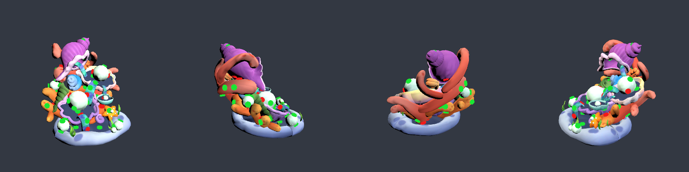
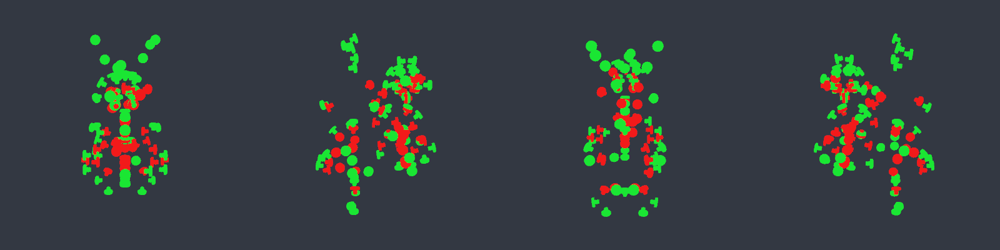

# LevelBake — граф блокировок уровней

Editor-инструмент, который из исходных префабов `Assets/UnscrewFirst20/Levels/Level_XX.prefab` и `Data/Level_XX.json`
строит `Assets/_Game/Data/Levels/Level_01..20.json` (`Unscrew.Core.LevelDefinition`, JsonUtility) с заполненными
`bolts[].blockingPartIds`, и проверяет, что каждый уровень полностью разбирается по `BoardRules`.

## Как запустить

- Меню **Unscrew → Bake Levels** или `Unscrew.Editor.Levels.LevelBaker.BakeAll()` (через `execute_code` / batchmode).
  Возвращает markdown-таблицу (как ниже), пишет 20 JSON и делает `AssetDatabase.Refresh`.
- Один уровень без записи: `LevelBaker.BakeLevel(n, overrides: null, write: false)` → `BakeResult`
  (определение, сырые попадания, разорванные циклы, метрики).
- Скриншоты: `LevelBakePreview.Capture(n, "Docs/Screens/bake_XX.png", yaws, size, pitch, xray)` — рендер уровня с 4 сторон
  во временной additive-сцене (закрывается без сохранения), болты: зелёный = доступен на старте, красный = заблокирован.
- Ручные правки: `Assets/_Game/Data/Levels/overrides.json` — `{"overrides":[{"level":5,"boltId":12,"add":[3],"remove":[7]}]}`,
  применяются после raycast, до разрыва циклов. Сейчас пусто.

Файлы: `Assets/_Game/Scripts/Editor/Levels/LevelBaker.cs`, `LevelBakePreview.cs`, asmdef `Assets/_Game/Scripts/Editor/Unscrew.Editor.asmdef`
(Editor-only, ссылается на `Unscrew.Core`). Бейк детерминирован: повторный прогон даёт побайтно те же JSON. Время ~1 с на все 20 уровней.

## Ось болта

Меш `Screw004`: длинная ось — локальная +Y; стержень внизу (радиус ~0.018), шляпка вверху (радиус 0.033, `bounds.max.y` = верх шляпки).
В префабе болта `Mesh` повёрнут на 90° по X внутри `TurnTrans` (scale 12), поэтому «наружу» = `transform.forward` болта.
Проверено: у 9/9 болтов Level_01 (и у большинства болтов остальных уровней) луч в `-axis` от шляпки сразу упирается в деталь-владельца,
а на скриншоте Level_01 шляпки видны с обеих сторон леденца (`bake_01.png`). Радиус шляпки в мире 0.40–0.48.

## Алгоритм

1. Префаб инстанцируется в preview-сцене (`EditorSceneManager.NewPreviewScene`, своя PhysicsScene), каждой детали — non-convex `MeshCollider`;
   на время бейка `Physics.queriesHitBackfaces = true` (оболочки ловятся и изнутри).
2. **Коридор извлечения**: `SphereCast` радиусом `0.6 × r_шляпки` от верха шляпки вдоль оси + центральный `Raycast`,
   длина `4 × r_шляпки` (~1.6–1.9 ед., ≈ 2.5 длины болта). Все детали ≠ владельца — блокеры.
   Попадания ближе `0.5 × r_шляпки` игнорируются (деталь лишь касается шляпки — болт на шве).
3. **Видимость**: шляпку «смотрим» из 400 направлений (сфера Фибоначчи) в конусе 75° вокруг оси. Если ни одно направление не свободно,
   к блокерам добавляются детали вдоль наименее загороженного направления (минимум деталей, при равенстве — ближе к оси).
   Так болты, спрятанные внутри модели, открываются только после снятия того, что их закрывает.
4. `overrides.json`.
5. **Циклы**: пока симуляция застревает, ищется цикл среди неснятых деталей (P → Q, если Q блокирует болт P) и выкидывается ребро
   с самым дальним блокером (из всех болтов P убирается Q). Каждое такое действие логируется (список ниже).
6. **Валидация**: JSON перечитывается `JsonUtility.FromJson<LevelDefinition>` и прогоняется волнами по `BoardRules.IsAccessible`
   (на каждой волне снимаются все доступные болты). «Глубина» = число волн. Дополнительно сверено независимым скриптом на Python.

### Подбор параметров

Сравнивались радиус каста 0.3/0.4/0.6/0.9/1.0, «кожа» 0/0.25/0.5/1/2, длина коридора 4/6/8/10/12/∞ радиусов шляпки — по двум
метрикам против независимой проверки видимости шляпки: «доступен на старте, но не виден» и «виден, но заблокирован», плюс число
разорванных рёбер. Бесконечный луч (как в исходном плане) давал 494 разорванных ребра и абсурдные блокировки: в чашке (L06)
болт на внутренней стенке «блокировался» противоположной стенкой через всю полость. Короткий коридор + проверка видимости дали
146 разорванных рёбер и согласие со скриншотами: все видимые снаружи болты зелёные, красные — внутри/под деталями.

## Результат

| Уровень | Деталей | Болтов | Скрыто в сборке | Заблокировано | Доступно на старте | Глубина | Разорвано рёбер | Overrides | Валиден |
| ---: | ---: | ---: | ---: | ---: | ---: | ---: | ---: | ---: | :---: |
| 1 | 4 | 9 | 0 | 0 | 9 (100%) | 1 | 0 | 0 | да |
| 2 | 19 | 42 | 8 | 10 | 32 (76%) | 3 | 0 | 0 | да |
| 3 | 24 | 54 | 21 | 22 | 32 (59%) | 5 | 0 | 0 | да |
| 4 | 59 | 75 | 19 | 25 | 50 (67%) | 6 | 0 | 0 | да |
| 5 | 43 | 87 | 19 | 34 | 53 (61%) | 7 | 4 | 0 | да |
| 6 | 37 | 81 | 57 | 49 | 32 (40%) | 9 | 18 | 0 | да |
| 7 | 32 | 93 | 48 | 38 | 55 (59%) | 8 | 15 | 0 | да |
| 8 | 48 | 81 | 15 | 17 | 64 (79%) | 4 | 0 | 0 | да |
| 9 | 44 | 90 | 26 | 33 | 57 (63%) | 7 | 0 | 0 | да |
| 10 | 43 | 84 | 42 | 45 | 39 (46%) | 8 | 2 | 0 | да |
| 11 | 24 | 93 | 54 | 38 | 55 (59%) | 5 | 18 | 0 | да |
| 12 | 24 | 75 | 9 | 25 | 50 (67%) | 8 | 5 | 0 | да |
| 13 | 22 | 84 | 26 | 30 | 54 (64%) | 5 | 4 | 0 | да |
| 14 | 47 | 87 | 25 | 33 | 54 (62%) | 7 | 0 | 0 | да |
| 15 | 56 | 108 | 61 | 61 | 47 (44%) | 6 | 0 | 0 | да |
| 16 | 21 | 72 | 10 | 16 | 56 (78%) | 7 | 0 | 0 | да |
| 17 | 24 | 93 | 50 | 36 | 57 (61%) | 7 | 16 | 0 | да |
| 18 | 29 | 93 | 40 | 45 | 48 (52%) | 6 | 20 | 0 | да |
| 19 | 38 | 99 | 47 | 45 | 54 (55%) | 11 | 44 | 0 | да |
| 20 | 54 | 111 | 51 | 54 | 57 (51%) | 5 | 0 | 0 | да |

Итого: 1611 болтов, на старте доступно 955 (59%), все 20 уровней валидны. «Скрыто в сборке» — болты, шляпка которых не видна снаружи
ни с одного направления; «Заблокировано» может быть меньше из-за разорванных циклов.

## Скриншоты

Зелёный — болт доступен на старте, красный — заблокирован. Ракурсы: спереди, справа, сзади, слева (камера игры смотрит по +Z).

- Level_01 (подтверждение оси, все 9 болтов доступны): 
- Level_06 (чашка, много болтов внутри): 
- Level_12: 
- Level_19 (больше всего циклов): 
- Level_19 без деталей — только болты, видно внутренние заблокированные: 

## Найденные проблемы данных и ограничения

- **Геометрические циклы** есть в 10 уровнях из 20 (максимум L19 — 44 ребра, L06/L11/L17/L18 — 15–20). Детали взаимно перекрывают
  болты друг друга; после разрыва часть болтов формально доступна, хотя в собранной модели их шляпка закрыта
  (~7% болтов на старте). Рекомендация для `unity-integrator`: тап по болту делать raycast'ом **только по слою болтов**
  (детали не перекрывают тап), источник истины доступности — `BoardRules`, а не видимость.
- Level_01 тривиален: блокировок нет, все 9 болтов доступны сразу (обучающий уровень).
- `sourceLayer` в исходном Level_01.json = 1/2 (а не 0, как сказано в скилле `level-data`); в остальных уровнях 0. Порядка разборки всё равно нет.
- В проекте **не назначен URP-ассет** (`GraphicsSettings.m_CustomRenderPipeline` пуст, URP-ассетов в Assets нет), поэтому материалы
  URP/Lit рендерятся пурпурными. `LevelBakePreview` для скриншотов временно подменяет материалы на built-in `Standard`. Нужна настройка проекта.
- `overrides.json` пуст — ручных правок пока не потребовалось.

## Журнал разорванных циклов

146 рёбер

- L05: cycle [6->9->6]: dropped part 6 blocking part 9 (dist 0,46)
- L05: cycle [2->20->2]: dropped part 2 blocking part 20 (dist 0,52)
- L05: cycle [25->39->25]: dropped part 25 blocking part 39 (dist 2,17)
- L05: cycle [25->42->25]: dropped part 25 blocking part 42 (dist 2,16)
- L06: cycle [31->2->31]: dropped part 31 blocking part 2 (dist 3,28)
- L06: cycle [13->11->5->13]: dropped part 5 blocking part 11 (dist 2,24)
- L06: cycle [13->11->13]: dropped part 13 blocking part 11 (dist 2,33)
- L06: cycle [13->29->5->13]: dropped part 29 blocking part 13 (dist 1,34)
- L06: cycle [13->34->4->13]: dropped part 13 blocking part 4 (dist 2,26)
- L06: cycle [4->35->4]: dropped part 35 blocking part 4 (dist 3,46)
- L06: cycle [13->34->13]: dropped part 34 blocking part 13 (dist 1,14)
- L06: cycle [14->15->32->14]: dropped part 14 blocking part 32 (dist 3,63)
- L06: cycle [15->32->15]: dropped part 32 blocking part 15 (dist 3,46)
- L06: cycle [30->14->30]: dropped part 14 blocking part 30 (dist 3,69)
- L06: cycle [31->30->31]: dropped part 31 blocking part 30 (dist 3,42)
- L06: cycle [31->35->31]: dropped part 31 blocking part 35 (dist 3,43)
- L06: cycle [29->5->29]: dropped part 29 blocking part 5 (dist 2,84)
- L06: cycle [29->32->29]: dropped part 29 blocking part 32 (dist 3,99)
- L06: cycle [34->29->34]: dropped part 29 blocking part 34 (dist 3,90)
- L06: cycle [35->34->35]: dropped part 34 blocking part 35 (dist 3,48)
- L06: cycle [28->22->33->27->28]: dropped part 28 blocking part 27 (dist 2,97)
- L06: cycle [7->36->7]: dropped part 36 blocking part 7 (dist 1,13)
- L07: cycle [3->4->3]: dropped part 4 blocking part 3 (dist 3,51)
- L07: cycle [7->3->7]: dropped part 3 blocking part 7 (dist 3,23)
- L07: cycle [7->8->4->3->7]: dropped part 8 blocking part 7 (dist 3,62)
- L07: cycle [8->4->8]: dropped part 8 blocking part 4 (dist 3,22)
- L07: cycle [6->5->6]: dropped part 6 blocking part 5 (dist 3,91)
- L07: cycle [5->9->5]: dropped part 9 blocking part 5 (dist 3,22)
- L07: cycle [6->10->6]: dropped part 10 blocking part 6 (dist 3,22)
- L07: cycle [12->6->12]: dropped part 12 blocking part 6 (dist 3,96)
- L07: cycle [12->11->12]: dropped part 12 blocking part 11 (dist 4,30)
- L07: cycle [11->14->11]: dropped part 11 blocking part 14 (dist 7,45)
- L07: cycle [12->11->14->12]: dropped part 12 blocking part 14 (dist 7,45)
- L07: cycle [11->15->11]: dropped part 11 blocking part 15 (dist 7,45)
- L07: cycle [12->11->15->12]: dropped part 12 blocking part 15 (dist 7,45)
- L07: cycle [9->10->9]: dropped part 10 blocking part 9 (dist 3,62)
- L07: cycle [20->27->20]: dropped part 20 blocking part 27 (dist 1,53)
- L10: cycle [4->5->11->4]: dropped part 4 blocking part 11 (dist 1,73)
- L10: cycle [4->5->17->4]: dropped part 17 blocking part 5 (dist 1,73)
- L11: cycle [2->19->2]: dropped part 2 blocking part 19 (dist 4,50)
- L11: cycle [2->19->12->2]: dropped part 19 blocking part 2 (dist 4,48)
- L11: cycle [2->22->2]: dropped part 22 blocking part 2 (dist 4,29)
- L11: cycle [12->5->12]: dropped part 12 blocking part 5 (dist 0,98)
- L11: cycle [19->12->5->19]: dropped part 19 blocking part 5 (dist 4,48)
- L11: cycle [6->7->6]: dropped part 7 blocking part 6 (dist 4,61)
- L11: cycle [19->12->6->19]: dropped part 12 blocking part 19 (dist 2,89)
- L11: cycle [19->22->13->6->19]: dropped part 6 blocking part 13 (dist 3,97)
- L11: cycle [19->22->13->14->7->6->19]: dropped part 6 blocking part 7 (dist 4,60)
- L11: cycle [19->22->13->14->7->19]: dropped part 22 blocking part 19 (dist 2,50)
- L11: cycle [13->14->13]: dropped part 14 blocking part 13 (dist 0,63)
- L11: cycle [12->13->17->12]: dropped part 12 blocking part 17 (dist 1,14)
- L11: cycle [13->17->13]: dropped part 13 blocking part 17 (dist 0,63)
- L11: cycle [13->17->14->13]: dropped part 14 blocking part 17 (dist 0,64)
- L11: cycle [13->21->22->13]: dropped part 21 blocking part 13 (dist 4,35)
- L11: cycle [14->20->22->14]: dropped part 22 blocking part 20 (dist 2,97)
- L11: cycle [14->22->14]: dropped part 22 blocking part 14 (dist 0,32)
- L11: cycle [21->22->21]: dropped part 22 blocking part 21 (dist 3,11)
- L12: cycle [4->22->4]: dropped part 4 blocking part 22 (dist 2,15)
- L12: cycle [4->22->5->4]: dropped part 22 blocking part 4 (dist 1,53)
- L12: cycle [19->16->19]: dropped part 19 blocking part 16 (dist 0,24)
- L12: cycle [6->18->6]: dropped part 18 blocking part 6 (dist 1,07)
- L12: cycle [9->12->9]: dropped part 12 blocking part 9 (dist 1,87)
- L13: cycle [3->13->3]: dropped part 13 blocking part 3 (dist 0,56)
- L13: cycle [2->20->2]: dropped part 20 blocking part 2 (dist 1,47)
- L13: cycle [11->17->11]: dropped part 11 blocking part 17 (dist 0,31)
- L13: cycle [15->16->15]: dropped part 15 blocking part 16 (dist 1,52)
- L17: cycle [1->2->1]: dropped part 2 blocking part 1 (dist 0,24)
- L17: cycle [1->23->2->1]: dropped part 2 blocking part 23 (dist 5,49)
- L17: cycle [2->19->2]: dropped part 2 blocking part 19 (dist 4,52)
- L17: cycle [2->19->12->2]: dropped part 19 blocking part 2 (dist 4,50)
- L17: cycle [2->22->2]: dropped part 22 blocking part 2 (dist 4,30)
- L17: cycle [12->5->12]: dropped part 5 blocking part 12 (dist 1,26)
- L17: cycle [6->7->6]: dropped part 7 blocking part 6 (dist 4,62)
- L17: cycle [19->12->6->19]: dropped part 12 blocking part 19 (dist 3,04)
- L17: cycle [19->22->19]: dropped part 19 blocking part 22 (dist 4,43)
- L17: cycle [19->22->20->19]: dropped part 22 blocking part 19 (dist 2,51)
- L17: cycle [14->13->14]: dropped part 14 blocking part 13 (dist 0,68)
- L17: cycle [13->17->13]: dropped part 13 blocking part 17 (dist 0,67)
- L17: cycle [14->13->17->14]: dropped part 17 blocking part 13 (dist 0,67)
- L17: cycle [14->17->14]: dropped part 14 blocking part 17 (dist 0,61)
- L17: cycle [20->22->20]: dropped part 22 blocking part 20 (dist 2,98)
- L17: cycle [21->22->21]: dropped part 22 blocking part 21 (dist 3,12)
- L18: cycle [0->3->0]: dropped part 3 blocking part 0 (dist 4,57)
- L18: cycle [0->4->0]: dropped part 0 blocking part 4 (dist 0,94)
- L18: cycle [0->4->3->0]: dropped part 0 blocking part 3 (dist 4,45)
- L18: cycle [3->2->3]: dropped part 3 blocking part 2 (dist 4,45)
- L18: cycle [0->4->3->2->27->0]: dropped part 0 blocking part 27 (dist 4,74)
- L18: cycle [2->27->2]: dropped part 2 blocking part 27 (dist 4,72)
- L18: cycle [2->27->9->5->2]: dropped part 27 blocking part 2 (dist 4,69)
- L18: cycle [9->5->9]: dropped part 9 blocking part 5 (dist 5,28)
- L18: cycle [9->5->27->9]: dropped part 27 blocking part 5 (dist 1,22)
- L18: cycle [9->12->9]: dropped part 9 blocking part 12 (dist 2,24)
- L18: cycle [9->12->13->9]: dropped part 13 blocking part 12 (dist 3,73)
- L18: cycle [9->13->9]: dropped part 13 blocking part 9 (dist 4,35)
- L18: cycle [1->19->1]: dropped part 19 blocking part 1 (dist 2,84)
- L18: cycle [14->24->14]: dropped part 24 blocking part 14 (dist 1,47)
- L18: cycle [14->28->24->14]: dropped part 14 blocking part 24 (dist 1,46)
- L18: cycle [21->19->21]: dropped part 19 blocking part 21 (dist 1,47)
- L18: cycle [21->20->21]: dropped part 21 blocking part 20 (dist 1,00)
- L18: cycle [24->21->20->24]: dropped part 21 blocking part 24 (dist 4,33)
- L18: cycle [24->26->24]: dropped part 24 blocking part 26 (dist 1,48)
- L18: cycle [28->24->26->28]: dropped part 26 blocking part 24 (dist 1,46)
- L19: cycle [5->9->13->5]: dropped part 5 blocking part 13 (dist 3,85)
- L19: cycle [5->9->13->6->1->5]: dropped part 5 blocking part 1 (dist 2,79)
- L19: cycle [6->1->6]: dropped part 1 blocking part 6 (dist 0,32)
- L19: cycle [9->13->6->2->9]: dropped part 2 blocking part 6 (dist 0,59)
- L19: cycle [5->9->13->6->5]: dropped part 9 blocking part 5 (dist 2,53)
- L19: cycle [6->11->6]: dropped part 11 blocking part 6 (dist 0,70)
- L19: cycle [13->12->13]: dropped part 13 blocking part 12 (dist 1,58)
- L19: cycle [9->13->12->15->23->9]: dropped part 9 blocking part 23 (dist 1,55)
- L19: cycle [2->9->13->12->15->23->22->2]: dropped part 23 blocking part 15 (dist 1,16)
- L19: cycle [13->12->16->13]: dropped part 13 blocking part 16 (dist 2,11)
- L19: cycle [12->16->18->12]: dropped part 18 blocking part 16 (dist 1,33)
- L19: cycle [12->16->19->12]: dropped part 19 blocking part 16 (dist 1,89)
- L19: cycle [12->18->12]: dropped part 12 blocking part 18 (dist 1,16)
- L19: cycle [13->12->18->13]: dropped part 13 blocking part 18 (dist 2,06)
- L19: cycle [2->9->13->12->18->17->2]: dropped part 17 blocking part 18 (dist 2,34)
- L19: cycle [2->9->13->12->18->21->2]: dropped part 2 blocking part 21 (dist 1,20)
- L19: cycle [9->13->12->18->21->9]: dropped part 21 blocking part 18 (dist 1,05)
- L19: cycle [12->19->12]: dropped part 19 blocking part 12 (dist 0,78)
- L19: cycle [13->14->13]: dropped part 13 blocking part 14 (dist 3,87)
- L19: cycle [13->20->13]: dropped part 13 blocking part 20 (dist 4,45)
- L19: cycle [2->9->17->2]: dropped part 2 blocking part 17 (dist 0,70)
- L19: cycle [17->19->17]: dropped part 19 blocking part 17 (dist 1,47)
- L19: cycle [9->19->21->9]: dropped part 21 blocking part 19 (dist 0,96)
- L19: cycle [2->9->19->23->22->2]: dropped part 22 blocking part 23 (dist 1,10)
- L19: cycle [2->9->19->23->25->22->2]: dropped part 22 blocking part 25 (dist 1,25)
- L19: cycle [23->25->23]: dropped part 23 blocking part 25 (dist 0,94)
- L19: cycle [9->19->23->25->27->9]: dropped part 27 blocking part 25 (dist 1,40)
- L19: cycle [9->19->23->25->31->21->9]: dropped part 21 blocking part 31 (dist 1,37)
- L19: cycle [2->9->19->23->25->31->22->2]: dropped part 22 blocking part 31 (dist 1,23)
- L19: cycle [25->31->25]: dropped part 31 blocking part 25 (dist 0,98)
- L19: cycle [2->9->19->23->25->33->22->2]: dropped part 22 blocking part 33 (dist 1,42)
- L19: cycle [9->19->23->25->33->28->21->9]: dropped part 33 blocking part 25 (dist 1,36)
- L19: cycle [2->9->19->23->30->22->2]: dropped part 22 blocking part 30 (dist 1,26)
- L19: cycle [23->30->23]: dropped part 30 blocking part 23 (dist 0,98)
- L19: cycle [9->19->27->9]: dropped part 9 blocking part 27 (dist 1,34)
- L19: cycle [2->9->19->27->22->2]: dropped part 22 blocking part 27 (dist 1,13)
- L19: cycle [2->9->19->27->26->22->2]: dropped part 22 blocking part 26 (dist 1,25)
- L19: cycle [27->26->27]: dropped part 26 blocking part 27 (dist 0,94)
- L19: cycle [2->9->19->27->32->22->2]: dropped part 22 blocking part 32 (dist 1,32)
- L19: cycle [27->32->27]: dropped part 32 blocking part 27 (dist 0,98)
- L19: cycle [9->21->9]: dropped part 9 blocking part 21 (dist 0,27)
- L19: cycle [2->9->22->2]: dropped part 2 blocking part 22 (dist 0,71)
- L19: cycle [26->28->26]: dropped part 28 blocking part 26 (dist 0,98)
- L19: cycle [26->33->28->26]: dropped part 33 blocking part 26 (dist 1,35)

