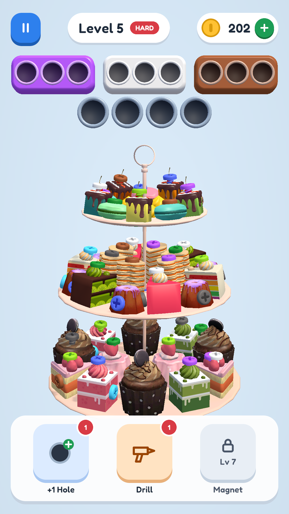

# Unscrew 3D — тестовое задание Unity-разработчика (AI-first)

Screw-пазл по референсу Screw Master / Screwdom 3D: 20 уровней на моделях из ТЗ, растущая сложность, бустеры, экономика, главное меню и магазин. Unity 2022.3.62f2 + URP 14, Android.

Игру почти целиком делали ИИ-агенты Claude Code, а человек выступал продюсером и гейм-дизайнером. Как это было устроено, описано в разделе [Процесс работы с ИИ](#процесс-работы-с-ии), полная хронология — в [`Docs/AI_LOG.md`](Docs/AI_LOG.md).



## Как запустить

**APK:** `Builds/Unscrew_<version>.apk` прикреплён к релизу репозитория. Ставится обычным способом (`adb install -r`).

**Редактор:**
1. Unity **2022.3.62f2** с модулем Android Build Support.
2. Открыть проект, сцену `Assets/Scenes/Main.unity`, нажать Play. Game view — портрет (есть пресеты 9:16 / 9:19.5).
3. Сборка APK: меню **Unscrew → Build Android APK** → `Builds/`.

Полезные меню и клавиши (только в редакторе):

| Что | Где |
|---|---|
| Пересобрать сцену и UI из кода | Unscrew → Build Game Scene / Build UI |
| Перебейк уровней и проверка правил | Unscrew → Validate Levels / Validate And Rebake Levels |
| Сверка UI с макетом | Unscrew → UI Spec Check |
| Следующий уровень / рестарт / бот проходит уровень / подсветка заблокированных | N / R / P / B в Play Mode |

**Тесты:**
- Ядро без Unity, за секунды: `bash Tools/CoreTests/test.sh All` (нужен .NET 8 SDK). Можно по модулю: `test.sh Board|Collect|Boosters|Economy|Generation`.
- Те же тесты в Unity: Test Runner → EditMode → `Unscrew.Core.Tests`.

## Игра

- **Механика.** Тап по болту, и он летит в коробку своего цвета, а если такой нет — в лунку буфера. Полная коробка уезжает, её место занимает следующая, и болты этого цвета из буфера переезжают в неё. Деталь, лишившаяся всех болтов, падает. Болт нельзя открутить, пока его путь перекрывает другая деталь.
- **Поражение** наступает только когда **ходов не осталось** (полный буфер — ещё не поражение). После поражения можно продолжить бустером «+1 Hole» или за монеты.
- **Бустеры:** +1 Hole, Drill (снять любой болт, даже заблокированный), Magnet (добить левую коробку). Открываются на уровнях 3/5/7, при открытии даётся 1 штука бесплатно.
- **Экономика:** монеты за уровень (hard ×2), магазин бустеров, «бесплатные монеты» (заглушка рекламы с перезарядкой), продолжение за монеты. Всё сохраняется.
- **Сложность:** каждый 5-й уровень hard. После 20-го начинается бесконечный режим (уровни 11–20 с новым seed).

## Архитектура

```
Assets/_Game/
  Scripts/Core/            чистый C# (asmdef без UnityEngine) — вся логика игры
    Contracts/             интерфейсы и данные: IBoard, ICollector, IGameSession, бустеры, экономика, генерация
    Board/                 Board, GameSession — доска, ходы, победа/поражение
    Collect/               Collector — коробки, буфер, каскады; события CollectEvent для анимаций
    Boosters/              BoosterService
    Economy/               кошелёк, инвентарь, прогресс, награды, магазин, сохранение через ISaveStorage
    Generation/            DifficultyCurve, LayoutGenerator (раскраска с гарантией проходимости), GreedySolver (бот)
    Composition/           LevelFactory — единственное место, где модули собираются вместе
  Scripts/Game/            MonoBehaviour-слой: View, Input, Flow (GameFlow), UI, Feel (VFX/звук), Meta, Debug
  Scripts/Editor/Levels/   бейк графа блокировок и валидатор уровней
  Data/Levels/             LevelDefinition JSON: детали, болты, blockingPartIds, headLift
  Tests/Core/              NUnit: модули + Integration (бот проходит все 20 реальных уровней)
Tools/CoreTests/           dotnet-проекты для прогона ядра без Unity (по проекту на модуль)
Docs/                      план, журнал ИИ, модули, макеты UI, QA, скриншоты
```

Ключевые решения:
- **Ядро не зависит от Unity.** Логика тестируется `dotnet test` за секунды, детерминирована (свой `Rng`) и одинаково работает в редакторе, на устройстве и в фоновом потоке, где генерируется уровень.
- **View только проигрывает события ядра.** `IGameSession.Tap` возвращает упорядоченный список `CollectEvent` и упавшие детали, а `BoardPresenter` превращает его в очередь анимаций. Правил игры в MonoBehaviour нет.
- **Уровни.** Граф блокировок не задан в ассетах, поэтому он **вычисляется при бейке** по правилам гейм-дизайнера: шляпка не утоплена в свою деталь (иначе болт поднимается на `headLift`), путь выкручивания (SphereCast радиусом шляпки на длину болта + отступ) не задевает другие детали. Итог проверяется: каждый уровень полностью разбирается.
- **Сложность измеряется.** Цель — доля побед «казуального игрока» (Monte-Carlo, 200 прогонов): от 100% на L1 до ~28% на L20, hard-уровни на 20–35 п.п. ниже соседей. Генератор подбирает раскладку под цель и при этом гарантирует, что уровень проходим без бустеров: бот проходит каждый уровень в тестах.
- **UI по макету.** Экраны нарисованы в Claude Design ([`Docs/Design`](Docs/Design)), значения перенесены в `UiTokens`, раскладка строится от safe area. `UiSpecCheck` сверяет 150 прямоугольников с макетом на трёх соотношениях сторон.

Документация по модулям: [`Docs/Modules`](Docs/Modules), план: [`Docs/Plan.md`](Docs/Plan.md).

## Процесс работы с ИИ

### Инструменты

| Инструмент | Зачем |
|---|---|
| **Claude Code** (Opus 5.5) в роли оркестратора | план, контракты между модулями, ревью и перепроверка работы агентов, мерж, журнал |
| **Саб-агенты Claude Code** ([`.claude/agents`](.claude/agents)) | `core-dev` (модули ядра, до 5 параллельно), `level-designer` (данные уровней), `unity-integrator` (всё в Unity), `qa-tester` (только читает и тестирует) |
| **Скиллы** ([`.claude/skills`](.claude/skills)) | `core-module`, `unity-verify`, `level-data`, `android-build`, `ai-journal` — повторяемые процедуры и «definition of done» для агентов |
| **UnityMCP** | агенты сами управляют редактором: сцены, префабы, консоль, тесты, Play Mode, скриншоты, профайлер |
| **Claude Design** | макеты экранов с сеткой и токенами — источник правды для UI |
| **dotnet test** | быстрые тесты ядра вне Unity, независимые сборки для параллельных агентов |
| **git worktree** | изоляция параллельных агентов: Unity не видит их промежуточного кода |

### Как организована параллельная работа

1. Оркестратор написал **контракты** (`Scripts/Core/Contracts`) и заморозил их до запуска агентов. Это единственная точка связи модулей.
2. Для каждого модуля свой dotnet-проект, который компилирует только `Contracts + модуль + его тесты`, поэтому недописанный код одного агента не ломает сборку другого.
3. Пять `core-dev` работали **одновременно**, каждый в своём git worktree на ветке `core/<module>`. В это же время `level-designer` в основном дереве — единственный, у кого был доступ к редактору Unity.
4. Перед мержем оркестратор перепроверял каждую ветку сам, а до готовности последней делал пробное слияние во временном worktree. В истории это видно как ветки `core/*`, слитые через `--no-ff`.

### Как ИИ проверял свои изменения

- **Тесты ядра:** 300 NUnit-тестов, они идут и в dotnet, и в Unity Test Runner.
- **Бот:** `GreedySolver` проходит все 20 реальных уровней и бесконечный режим — и в тестах, и через настоящий view с анимациями (`DebugAutoplay`).
- **Измеримые проверки вместо «на глаз»:** валидатор уровней (правила 1–2, полная разборка), Monte-Carlo сложности, `UiSpecCheck` (150/150 прямоугольников против чисел из макета, а не из кода).
- **Визуальный цикл:** агенты делали скриншоты Play Mode через MCP, **сами их смотрели** и исправляли найденное. Примеры: ложные блокировки через полость чашки, эллиптические концы пилюль, мелкие болты.
- **Независимый QA-агент**, который не правит код: полный прогон и таблица багов ([`Docs/QA`](Docs/QA)), затем отдельный проход с исправлениями.
- **Оркестратор не верил отчётам на слово:** перезапускал тесты в worktree агента и просматривал ключевые скриншоты.

### Что сделал человек, а что агенты

**Человек:**
- создал Unity-проект, поставил URP, импортировал ассеты, подключил UnityMCP, сделал `git init`;
- ставил задачи;
- **принимал гейм-дизайнерские решения:** правила корректности уровней (шляпка не в меше, SphereCast по пути выкручивания), правило поражения «out of moves», вариант исправления утопленных болтов, использование Claude Design для экранов;
- ревьюил результат.

**Агенты:** весь код, тесты, бейк данных, UI, звук (синтезирован процедурно), сборка APK, документация. Каждый агентский коммит помечен трейлером `Co-Authored-By: Claude`.

### Примеры промптов

> Для начала составь план, какие саб-агенты и скиллы нужно создать, как быстрее всего реализовать рабочую игру.

> Пусть с core-dev работают сразу несколько агентов, каждому по механике, которые можно делать параллельно, независимо друг от друга, в связи с этим адаптируй CLAUDE.md и скиллы.

> Вводим правила для проверки корректности уровней: 1. Шляпки болтов не находятся внутри меша, к которому он прикручен. 2. При выкручивании болт не задевает соседние меши (вместо raycast используем SphereCast с радиусом болта, на дистанцию, на которую болт выезжает при выкручивании). […] Поражение должно происходить только в случае, когда не осталось ходов (out of moves).

> Для экранов можешь использовать Claude Design, чтобы корректно сделать UI, с одинаковыми отступами, равномерным заполнением и т.п.

Промпты, которые оркестратор писал саб-агентам, и решения по каждому этапу собраны в [`Docs/AI_LOG.md`](Docs/AI_LOG.md).

### Что пошло не так и как это поймали

- **Бейк по бесконечному лучу** дал 494 ложные блокировки. Агент увидел это на скриншотах и перешёл на короткий коридор, а затем по решению человека — на SphereCast.
- **После смены правила поражения** даже специально плохая игра выигрывала часть уровней. Это поймал интеграционный тест. Дальше агент **измерил**, что старые «ручки» сложности почти не работают, и переделал генератор.
- **В Magnet при полном буфере** болты снимались в таком порядке, что сессия могла перейти в поражение посреди серии. Это поймал тест, порядок изменён.
- **Дважды кончился лимит API** посреди работы агента. Агенты продолжили с того же места через SendMessage, наработки не потерялись.
- **QA нашёл 10 багов** (критичных 0), они исправлены отдельным проходом.
